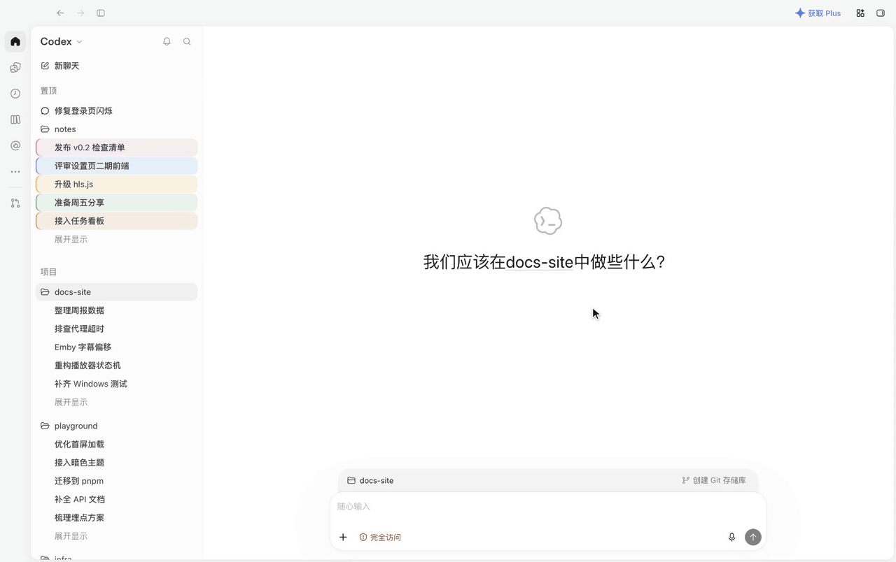
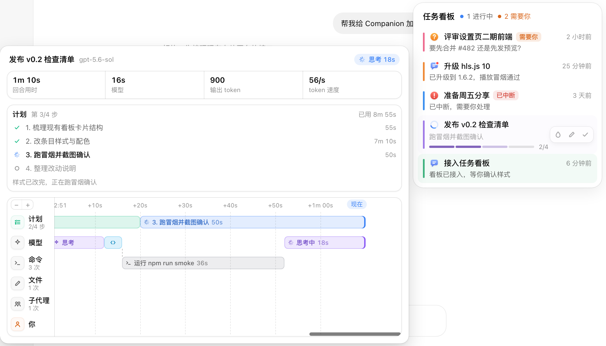
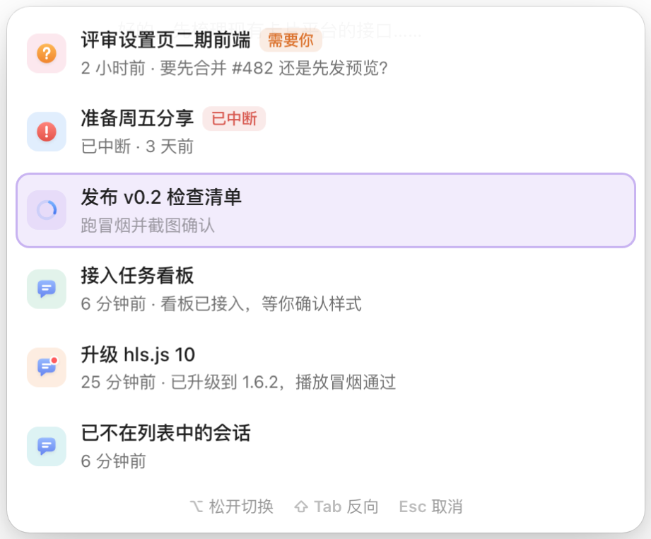
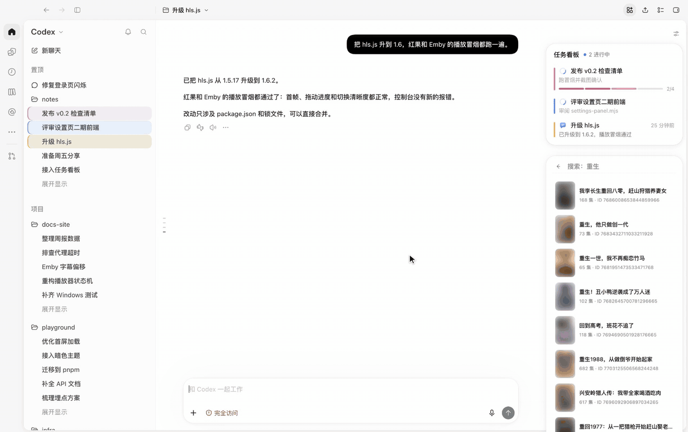

# Codex Companion

[简体中文](README.md) | **English**

Codex Companion is a card platform for the Codex desktop app (macOS / Linux). It adds an extensible
card area next to the conversation and hands the job of writing cards to the AI. A card is a single
directory with a small contract: tell Codex what you want, it writes the card following the conventions
in this repository, and the card shows up next to your chat after a reinstall.

The platform also ships with several ready-to-use cards: a task board that tracks progress across
sessions, a Hongguo short-drama player, an Emby player, and a proxy status card.

Companion runs as a background service. Install it once, then just open Codex as usual. It does not
modify `app.asar`, the Codex installation, or the app signature.

> Codex Companion is an unofficial project. It is not affiliated with, authorized by, or endorsed by
> OpenAI, ChatGPT, Codex, ByteDance, Hongguo, or Emby. All names and trademarks belong to their respective owners.

> The user interface is currently available in Chinese only.



## Contents

- [Features](#features)
- [Built-in cards](#built-in-cards)
- [Let the AI write a card](#let-the-ai-write-a-card)
- [Installation](#installation)
- [Usage](#usage)
- [How it works](#how-it-works)
- [Security and privacy](#security-and-privacy)
- [Known limitations](#known-limitations)
- [Development](#development)
- [Uninstalling](#uninstalling)
- [Contributing and license](#contributing-and-license)

## Features

- **Cards defined by AI.** A card is a directory under `src/cards/<id>/` (a manifest, a renderer entry,
  and an optional backend service). `AGENTS.md` documents the card contract, so Codex can add a card on its own.
- **The platform handles the common parts.** Frame and layout, Shadow DOM style isolation, enabling and
  ordering, lifecycle, local persistence, RPC between the page and the backend, and resource cleanup.
  A card only implements its own UI and logic.
- **Capability-based access.** A card declares the capabilities it needs in its manifest (storage,
  backend RPC, the session list, top-level overlays). Undeclared capabilities are not available to it.
- **Built-in cards that work out of the box.** Task board, Hongguo, Emby, and proxy status.
  Each can be enabled, disabled, and reordered, and follows Codex's light and dark themes.
- **Codex is left untouched.** The UI is injected through a debugging port bound to the loopback
  address. The background service starts at login and recovers automatically after a crash.

## Built-in cards

| Card | Purpose | Default |
|---|---|---|
| **Task board** | Pins the Codex sessions you are working on in one place, with live status, plan progress, and a per-session trace | On |
| **Hongguo** | Browse, search, save, pick episodes, play, and auto-play the next episode (requires FFmpeg) | On |
| **Emby** | Connects to a self-hosted Emby server: libraries, search, source selection, subtitles, resume, and progress reporting | On |
| **Proxy status** | Shows the proxy Codex was launched with and whether the local port is reachable | On |

### Task board

When several Codex sessions are running at once, you no longer need to open each one to check on it.

- **Everything in one place.** Once a session is added to the board, sessions waiting for your answer,
  interrupted sessions, and sessions that have been silent for a long time are listed first, followed by
  unread replies, then sessions still in progress.
- **Plan progress.** When Codex lays out a plan, the task shows a segmented progress bar and the step
  currently being worked on.
- **Per-session trace.** Hover over a task to open a timeline of that session, split into lanes for the
  plan, the model, commands, files, sub-agents, and you. Failures and moments waiting for your input are highlighted.
- **Quick switching.** On macOS, hold Option and press Tab to switch between board sessions, the same way ⌘Tab switches apps; ⌥J jumps straight to a session that needs you.
- **Auto-add.** Optionally, sessions you start in Codex join the board on their own.
- **Watch while you wait.** While a video plays in a card, playback pauses with an alert when a task needs you,
  and you get a brief alert when one finishes, even in fullscreen.





### Hongguo

Browse recommendations, search for series, keep a watchlist, pick an episode, and auto-play the next
one. Multi-season series can switch seasons. The card reads content through the unofficial SDK
[openhongguo](https://github.com/beilunyang/openhongguo), and playback requires FFmpeg on your machine.
Before using it, read the playback and compliance notes in the [Hongguo usage section](#hongguo-1).

Watch while you wait: when a task on the board needs you, the video pauses and an alert appears; click
"去处理" (Handle it) to jump to that session. Posters and video are blurred in the demo.



### Emby

Connect to a self-hosted Emby server and keep watching next to your conversation: multiple servers,
libraries, continue watching, recently added, search, season and episode selection, source selection,
subtitles, and progress reporting. Formats that can play directly do so; HEVC, Dolby Vision, image-based
subtitles and similar cases are handled by FFmpeg on your machine.

## Let the AI write a card

The card platform is designed so that an AI can build a card end to end. Open Codex in the repository
directory and describe what you want, for example:

```text
Add a "Pomodoro" card to Companion: 25 minutes of focus and 5 minutes of rest, with start, pause,
and reset, and remember how many pomodoros I finished today. Follow the card conventions in AGENTS.md.
```

Codex follows the conventions and performs these steps. You can also run them yourself:

```sh
npm run card:create -- pomodoro --title Pomodoro   # scaffold the card; add --service for a backend service
# edit the files under src/cards/pomodoro/
npm start                                          # regenerate and restart the background service
```

New cards are disabled by default. Enable the card in the card area settings (the gear icon) to see it.

A card consists of these files:

| File | Role |
|---|---|
| `manifest.json` | Card manifest: `id`, title, default state and order, layout, lifecycle, storage scope, required capabilities |
| `renderer.mjs` | Page entry. Exports `mount(ctx)` and renders the UI inside the ShadowRoot provided by the platform |
| `service.mjs` | Optional backend service. Exports `createService()`; methods are exposed to this card as `<card id>.<method>` |

Capabilities a manifest can declare:

| Capability | Description |
|---|---|
| `storage` | Versioned, validated local persistence |
| `rpc` | Calls to the card's own backend service. Requests are namespaced to the card and cancelled when the card unmounts |
| `threads` | Read the session list in the Codex sidebar, and locate and open sessions |
| `overlay` | Show a top-level overlay outside the card area |

The full contract is in the "新增卡片" (Adding a card) section of [AGENTS.md](AGENTS.md). Cards are built
together with the repository; no external code is loaded at runtime.

## Installation

### Platform support

| Platform | How cards are loaded | Data directory |
|---|---|---|
| macOS (Apple Silicon / Intel) | The background service detects a freshly opened Codex, quits it gracefully, and reopens it with debugging flags | `~/Library/Application Support/codex-companion/` |
| Linux (preview, x64 / ARM64) | Overrides the ChatGPT entry in the application menu so it launches with debugging flags; no reopen needed | `~/.config/codex-companion/` |

Linux support is a preview: installation, launch, connection, injection, and RPC have been verified, but
card placement in the signed-in session view has not been verified on Linux. Windows is not supported yet.

### Requirements

- The Codex desktop app on macOS, or the official ChatGPT desktop app installed from deb / rpm on Linux
  (`/usr/lib/chatgpt/ChatGPT`; use `CODEX_COMPANION_CODEX_EXECUTABLE` for other locations).
- For a source installation: git, Node.js 22+, and npm (installing dependencies provides a pinned version of
  Bun). A Homebrew installation only needs Homebrew, which installs Node.js and FFmpeg.
- On macOS, Xcode Command Line Tools (`xcode-select --install`), used to compile the native helper that
  detects and reopens Codex.
- On Linux, systemd user services (`systemctl --user`). Optional: `notify-send` (libnotify) for reopen
  prompts, and `secret-tool` (libsecret) for storing the Emby token. Without it, the token is stored in a
  `0600` file in the data directory.
- **FFmpeg.** Required for Hongguo playback. Also used by Emby for HEVC, EC-3, MKV, very high bitrate
  media, and image-based subtitles. Emby HLS, regular MP4, and the other cards do not need it. The project
  does not bundle FFmpeg; it only looks in `CODEX_COMPANION_FFMPEG`, `PATH`, and the Homebrew / MacPorts
  directories (plus `/usr/bin`, snap, and Linuxbrew on Linux).

Local Dolby Vision / HDR playback on macOS requires `brew install ffmpeg-full molten-vk`. P5/P8 is mapped
to BT.709 SDR using the RPU, and HDR10/HLG is tone-mapped. This is not native HDR output.

### Install with Homebrew (macOS)

```sh
brew tap foriLLL/codex-companion https://github.com/foriLLL/codex_companion
brew trust --formula foriLLL/codex-companion/codex-companion
brew install codex-companion
codex-companion agent install
```

Since Homebrew 7, formulae from third-party taps must be trusted before they load; the second command
trusts only this formula. Homebrew installs Node.js and FFmpeg, generates the card renderer, and compiles
the native helper on your machine; the last command registers the background service that starts at login.
Reopen Codex afterwards to see the cards.

After that, the background service keeps Companion on the latest release by itself; see [Updates](#updates).
To upgrade by hand:

```sh
brew upgrade codex-companion && codex-companion agent install
```

To follow the latest code on `main`, install with `brew install --HEAD codex-companion` and add `--fetch-HEAD`
when upgrading by hand; automatic updates still only run when a new release is published. The background
service points at Homebrew's stable paths, so Homebrew upgrading Node.js does not break it. Homebrew and source
installations share the same background service and data directory, so install only one; whichever ran
`agent install` last is the one in use.

### Install from source

```sh
git clone https://github.com/foriLLL/codex_companion.git
cd codex_companion
npm ci
npm start
```

`npm start` does the following in one go:

1. Generates the card renderer.
2. On macOS, compiles the native helper. If the Command Line Tools are missing, it stops and asks you to
   run `xcode-select --install` first.
3. Checks for FFmpeg. On macOS, if FFmpeg is missing and Homebrew is available, it runs
   `brew install ffmpeg` automatically (set `CODEX_COMPANION_SKIP_FFMPEG=1` to skip). Otherwise it only
   prints a notice and you need to install FFmpeg yourself:

   | System | Command |
   |---|---|
   | macOS | Install [Homebrew](https://brew.sh/), then run `brew install ffmpeg` |
   | Debian / Ubuntu | `sudo apt install ffmpeg` |
   | Fedora | `sudo dnf install ffmpeg-free` |

   FFmpeg can be installed later without reinstalling Companion.
4. Registers a background service that starts at login and runs the current source tree (macOS: launchd;
   Linux: a systemd user service plus the menu entry override).

Reopen Codex after installation to see the cards. The background service runs your current Node and the
source in this repository directory, so **do not delete or move the repository after installing** (run
`npm start` again if you move it). To update, run `git pull && npm ci && npm start` in the repository (when a
new release is out, the settings remind you and show this command, but never run it for you); also
run `npm start` again after switching Node versions with nvm, fnm, or similar tools.

### Release builds (not published yet)

The signed `.app` and the Linux single-file backend are not attached to GitHub Releases yet, so the command below
does not work for now. Once they are published, it will install Companion without Node.js:

```sh
curl -fsSL https://github.com/foriLLL/codex_companion/releases/latest/download/install.sh | bash
```

On macOS, the installer downloads `Codex Companion.app`, signed with a Developer ID and notarized by
Apple, verifies it, installs it to `~/Applications`, and opens the onboarding window. Click "启用自动加载"
(Enable auto-load) there to register the background service that starts at login (approve it under
System Settings › General › Login Items if asked). If Homebrew is present, FFmpeg is installed as well.

On Linux, install the official ChatGPT desktop app first, then run the same command. The installer
downloads the single-file backend of the same version, verifies it against the SHA256 written into the
script at release time, places it in `~/.local/share/codex-companion`, registers a systemd user service,
and overrides the ChatGPT entry in the application menu. No sudo is required. Afterwards, open ChatGPT
from the application menu. If ChatGPT was already running during installation, quit it and reopen it from
the menu once. FFmpeg must be installed separately.

### Files written on Linux

Installation writes two files: `~/.config/systemd/user/codex-companion-agent.service`, and
`~/.local/share/applications/chatgpt.desktop`, which shadows the system entry of the same name. The latter
only replaces the launch command with Companion's entry point; the name, icon, and protocol associations
such as `codex://` stay the same. If you already have your own file at that location, installation stops
and does not overwrite it.

### First launch

**macOS.** When Codex has just started (within 8 seconds) and is in the foreground, the background service
(launchd `com.codexcompanion.agent`) asks it to quit normally, then reopens it with
`--remote-debugging-address=127.0.0.1` and a random port and injects the cards. Clicking or typing right
after launch does not prevent the reopen. A Codex instance that has been running longer is never quit
automatically; you are only notified that a reopen is needed. Automatic reopens are at least two minutes apart.

After injection, a Companion entry appears in the Codex top bar; click it to show the cards. In the
settings (the gear icon in the card area) you can place the cards below the native summary instead. If
the background service crashes, launchd restarts it and it reconnects to the Codex instance that already
has the debugging port open.

**Linux.** Open ChatGPT from the application menu. The entry launches it with
`--remote-debugging-address=127.0.0.1` and a random port; the resident service discovers it, connects, and
injects the cards. Running `chatgpt` directly in a terminal, or having ChatGPT already open during
installation, does not include the debugging flags; you will be asked to quit and reopen it from the
application menu. Companion never quits or restarts ChatGPT automatically on Linux, so after changing the
launch proxy you also need to reopen it from the menu yourself.

## Usage

- Enable, disable, and reorder cards in the settings. Disabling a card keeps its saved data.
- After saving the "Codex 启动代理" (Codex launch proxy) preference, click "保存并重启" (Save and restart) to apply it.
- Collapsing a card keeps its page state. Closing the page, cancelling a request, or stopping the backend
  releases media sessions, Blob URLs, segment caches, and transcoding processes.

### Updates

Versions are the [GitHub Releases](https://github.com/foriLLL/codex_companion/releases) tagged `vX.Y.Z` in this
repository. The background service checks 2 minutes after it starts and every 6 hours after that; "更新" (Updates)
in the settings also lets you check by hand and shows the current version and release notes.

- **Homebrew installations** update automatically by default. When a new release is found, the service runs
  `brew update` and `brew upgrade codex-companion` in the background (Homebrew may also upgrade outdated
  dependencies such as Node.js or FFmpeg), then restarts Companion's background service on the new version.
  Codex itself is not restarted. If a video is playing in a card, the restart waits until playback stops.
  Once the new version is running, the old version is removed from Homebrew.
  Afterwards a red dot on "卡片配置" (Card settings) points to the release notes, which the settings show in the
  "更新" (Updates) group moved to the top. Turning off "自动更新" (Automatic updates) switches to a reminder: the red
  dot appears within a few minutes of a release being found (or when you switch back to Codex), and the update
  only installs when you click "立即更新" (Update now).
- **Source installations** only get a reminder with the update command; Companion never runs `git pull` for you,
  so local changes are safe.
- When "通过代理启动" (Launch through proxy) is on, checking and upgrading use the same local proxy.

Installations older than 0.2.0 have no automatic updates yet and need one manual upgrade:

```sh
curl -fsSL https://raw.githubusercontent.com/foriLLL/codex_companion/main/scripts/upgrade.sh | bash
```

The script picks the installation the registered background service runs. For Homebrew it upgrades the formula and
registers the service again, switching a `--HEAD` installation to the release. For a source checkout it pulls and
reruns `npm start` only when the checkout is on main with no uncommitted changes; otherwise it stops, explains why
and leaves the checkout alone. If the service does not point at your checkout, pass the path
(`| bash -s -- /path/to/codex_companion`). Add `--dry-run` to print the commands without running them.

### Task board

- Open a session and click "加入当前会话" (Add current session). It stays on the board, and the matching
  entry in the left sidebar is marked with the same color. Click ✓ when done to remove it; you can undo
  within a few seconds. The board keeps up to 100 tasks.
- With "新会话自动加入看板" (Add new sessions automatically) turned on under "任务看板" (Task board) in the
  settings, sessions you start in the Codex desktop app (including forks into a new session) join the board
  on their own and are not added again once removed. The Codex CLI in a terminal, `codex exec`, sub-agents,
  and side chats are skipped; sessions from before the switch was turned on, or created while the background
  service was restarting, are not added.
- Status icons update in real time. Sessions waiting for your answer, interrupted sessions, and sessions
  with no response for more than 15 minutes come first, then unread replies, then sessions in progress.
  You are reminded about turns that finished but that you have not looked at. Clicking a task locates and
  opens the session in the sidebar.
- A task's name follows the Codex session title by default and can be renamed (this only changes the
  board, not Codex). Colors can be adjusted individually.
- Hover over a task for a moment and the session's trace opens to the left of the board: a timeline split
  into lanes for the model, commands, files, sub-agents, and you, with failures and moments waiting for
  your input highlighted. Move the pointer into the panel to scroll and zoom; press Esc to close.
- On macOS, hold Option and press Tab repeatedly to open the list of board sessions in the middle of the
  window (most recently opened first; the order survives background service restarts and updates), and
  release Option to switch. A single quick press returns to the previous session. Shift+Tab or the arrow keys
  go backwards, 1–9 jump straight to a row, Esc cancels, and you can also click with the mouse. In the panel,
  W removes the selected session from the board and Z undoes it. Rows show plan progress too; sessions whose
  records can no longer be found are left out. This works while the cards are collapsed and does not
  intercept keys when the board is empty.
- Hold Option and press J to jump to a session that needs you: first unread ones waiting for your answer,
  interrupted, or gone quiet, then unread replies, then ones you have seen that are still waiting. Press again
  to move on to the next; if there is none, a short note appears at the top of the window. While a playback
  alert is showing, ⌥J does the same as "去处理" (Handle).
- Under "任务看板" (Task board) in the settings you can turn these shortcuts off, switch Option to Control
  (⌃Tab / ⌃J, which takes over Codex's switch-tab shortcut; useful when a window switcher such as AltTab
  already owns ⌥Tab), or have the panel also list recently opened sessions that are not on the board. They
  are not offered on Linux, where desktop environments reserve Alt+Tab and Ctrl+Tab switches Codex tabs.
- While a video plays in a card (Hongguo, Emby, and so on), a board task that is waiting for your answer, was
  interrupted, or has gone quiet for a long time pauses playback and shows an alert next to the video. A
  finished turn only shows an alert, which closes after a few seconds. In fullscreen the alert appears over
  the video; "去处理" (Handle) leaves fullscreen and opens the session, and "继续播放" (Resume) keeps watching.
  Under "任务看板" (Task board) in the settings, "任务需要你时" (When a task needs you) and "任务完成时"
  (When a task finishes) can each be set to off, alert, or pause. Nothing is shown when nothing is playing,
  and changes from before the board started syncing are not replayed.

**Plan progress**

- When Codex lists steps with its plan tool (`update_plan`) or a dedicated progress message
  (`companion-plan`), the task shows a segmented progress bar with the number of completed steps, and a
  task in progress shows the current step on its second line. The trace gains a "计划" (Plan) section
  (status and duration of each step) and a plan lane. Without a plan, the trace lists the phases Codex went
  through based on its progress notes.
- With "长任务先列计划" on, Companion turns on Codex's built-in `update_plan` tool (off by default) in
  `config.toml`, so progress goes through tool calls and stays out of the conversation. Only when the tool is
  unavailable does the assistant fall back to a progress message: it emits one `companion-plan` code
  block in a progress message (`commentary`) containing a complete JSON snapshot, for example
  `{"plan":[{"step":"Check current state","status":"completed"},{"step":"Verify results","status":"in_progress"}]}`.
  Progress notes may appear before and after the block. Only a single, complete, non-quoted, non-nested plan
  block is accepted; user messages, tool output, and final answers are never treated as plans. The
  `companion-plan` marker is reserved for real progress reports, so protocol examples should use a regular
  `json` code block to avoid being read as current progress. Status must be `pending`, `in_progress`, or
  `completed`, with at most one step in progress. Without a snapshot, overall completion is not guessed.

**Plan first for long tasks**

The "长任务先列计划" switch is off by default. Turning it on first shows a confirmation explaining that
Codex's global instructions will be modified; you can expand it to read the exact rules that will be
appended. The setting is saved only after you click "同意修改并开启" (Agree and enable). Cancelling or
closing the settings leaves it off.

After confirmation, a marked block is appended to Codex's global instruction file (`~/.codex/AGENTS.md`,
or `AGENTS.override.md` when that file is not empty). It asks Codex to list a plan before tasks expected to
take three or more steps or more than five minutes, and to update the plan after each step. This block
becomes part of the model context and affects all new sessions, not only the current project or the tasks
on the board. It does not rewrite your input and does not guarantee that a task is completed correctly. Its
only purpose is to give the board structured step progress; it does not enable Plan Mode or change
permissions.

It also appends `[tools.update_plan]` with `enabled = true`, under a marker comment, to the end of
`~/.codex/config.toml`. This turns on Codex's built-in plan tool, which is off by default, so plan progress no
longer appears as code blocks in the conversation. If you already configured `update_plan` yourself (or wrote
`tools` as an inline table or dotted keys at the top level), Companion leaves it alone and your setting wins.

In both files Companion only adds or removes its own content, and removes it when you turn the switch off,
disable the task board, or uninstall Companion. Sessions that already loaded the rules are not reverted.

### Hongguo

The card reads Hongguo's public catalog and playback addresses through the unofficial SDK
[openhongguo](https://github.com/beilunyang/openhongguo). The SDK is distributed with the app as wasm and
needs no separate installation. It requests content with an anonymous device profile generated on your
machine and does not accept a signed-in account.

**Playback.** The backend passes the signed URL directly to FFmpeg on your machine (playback is impossible
without FFmpeg; see [Installation](#installation)), which uses `-decryption_key` to decrypt streams protected
by a content key and converts them to H.264/AAC fMP4. The result is delivered to the page in bounded RPC
chunks and played through MSE. HEVC sources are always transcoded to avoid unstable decoding in Chromium.
In other words, protected episodes are decrypted locally with a content key obtained by the SDK. This is not
a playback method provided by Hongguo. During playback, the signed URL and the content key appear in
FFmpeg's command-line arguments and are visible to other processes run by the same user.

**Browsing and auto-play.** Search is limited to the series category and supports paging. Missing covers are
filled in from the SDK's batch details, and multi-season series can switch seasons on the episode page. The
next episode starts immediately when the current one ends; the last episode keeps a replay option. If
recommendations fail to load, only a local notice is shown and search and watchlist playback keep working.
Leaving the home view cancels recommendation requests and background retries. While the Codex window is
hidden, the MediaSource startup timeout is paused and resumes when the window returns; cancelling playback
still releases resources immediately.

**Limits.** Hongguo allows playback per anonymous device. When requests are rate-limited, the card switches
to another device and retries, so the playback quota is counted per device. The card only shows series for
which the SDK can obtain an address. Content that has been taken down, requires sign-in, or requires
verification results in an error.

**Compliance.** Content and access rules may change at any time, and this card may stop working as a
result. You are responsible for confirming that the laws where you live, the site's terms, and content
rights allow this kind of access. This project does not provide, host, or license any video content.

### Emby

Enter the server address, username, and password the first time you open the card. `emby.json` (`0600`) in
the data directory stores only the server address and identifier, UserId, username, and DeviceId. Each
AccessToken is stored separately in the system credential store (service `codex-companion.emby`). The
password is never written to disk.

When several media versions exist, a manual choice always wins. By default the card keeps subtitles and the
highest resolution tier, prefers progressive sources, and estimates the cost of input, transcoded output,
and page decoding. Playback paths:

1. H.264/AAC HLS when the server allows transcoding.
2. Compatible H.264/AAC MP4 plays natively through CDP media interception, or is segmented with MP4Box and
   played through bounded RPC chunks and MSE.
3. Very high bitrate MP4, HEVC, EC-3, multiple audio tracks, other containers, and burned-in image-based
   subtitles go through FFmpeg on your machine, which outputs H.264/AAC fMP4.

Text subtitles such as SRT, WebVTT, ASS, and SSA are rendered separately by the player (ASS/SSA are
converted to WebVTT locally), so video is not re-encoded just to show text. Image-based subtitles such as
PGS, VobSub, and DVB must be burned in. When local processing is needed and FFmpeg is missing, the UI asks
you to install FFmpeg or point to it.

Before connecting, you can run a read-only probe (the password is entered in the terminal without echo and
nothing is written to the configuration or the credential store):

```sh
npm run probe:emby -- --server https://emby.example.com --username alice --search "three body"
```

## How it works

1. A resident background service (through a native helper on macOS) watches Codex start, reopens it under
   safe conditions with a random debugging port on loopback, and injects the card renderer over CDP.
2. The page talks to the backend over RPC through a CDP binding; only calls from the top-level page are
   handled. All cards share the renderer, the service registry, and lifecycle management.
3. The backend accesses Hongguo, Emby, and the allowed media CDNs. The page never handles credentials directly.
4. Media is played through a 127.0.0.1 local proxy (HLS), CDP media interception, or bounded RPC chunks
   plus MSE. Every response, backend queue, segment cache, and page buffer has an upper bound.
5. Going back, seeking, switching episodes, signing out, or closing the page cancels the corresponding
   requests and releases resources. A heartbeat timeout triggers cleanup as well.

Injection depends on Codex's DOM structure and may need updating when Codex changes. Logs are in
`~/Library/Logs/codex-companion/agent.log` (Linux: `journalctl --user -u codex-companion-agent`), and
`node src/cli.mjs agent status` prints the current status.

## Security and privacy

- **Debugging port.** The CDP debugging port is always bound to loopback on a random port and must never be
  exposed to the local network or the internet.
- **Card isolation.** Cards, request generations, and media chunks are bound to each other. Once a card is
  closed or disabled, old chunks can no longer be read.
- **Emby credentials.** The token is only sent to the configured Emby origin and never enters the DOM, media
  URLs, the FFmpeg command line, or logs.
- **Media addresses.** Cross-origin media CDNs must use HTTPS and pass address, DNS, and public IP checks.
- **Dependencies.** Versions are pinned by `package-lock.json`. No CDN scripts are loaded at runtime.
- **Update checks.** The background service periodically asks `api.github.com` for this repository's latest
  release. When the GitHub API is rate limited, it reads the `releases/latest` redirect on `github.com` and that
  version's CHANGELOG on `raw.githubusercontent.com` instead. The requests only carry `codex-companion/<version>` as its user agent and sends no local data; the
  result is kept in `update-state.json` (`0600`) in the data directory.
- **Hongguo.** The anonymous device profile is stored in `hongguo/anonymous.json` in the data directory and
  reused for later requests. Covers are only loaded from Hongguo CDN HTTPS addresses found in already loaded
  content; each connection validates and pins a public IP, and redirects are validated hop by hop. Watchlist
  input cannot add unknown cover addresses. During playback, the signed URL and the content key appear in
  FFmpeg's command-line arguments.
- **Task board.** It only reads session records, `session_index.jsonl`, and `.codex-global-state.json` in the
  local Codex data directory (`~/.codex`, or `CODEX_HOME`), and uploads nothing. The only writes are the marked
  blocks in `AGENTS.md` and `config.toml` after you turn on "长任务先列计划". The board's own task list is stored in
  `task-board.json` in the data directory, and the recently-opened order used by the shortcuts in `task-recent.json`.
  With "新会话自动加入看板" on, the background service lists today's and yesterday's folders under `sessions` every
  2 seconds and reads only the first line of new files to tell where they came from.

Please report security issues privately as described in [SECURITY.md](SECURITY.md). Do not post tokens,
server addresses, raw logs, or other private information in public issues.

## Known limitations

- Emby Connect, server auto-discovery, Live TV, audio libraries, and DRM are not supported. TLS verification
  is never disabled, and self-signed Emby HTTPS is not supported.
- Media pauses when you switch to another card. Emby auto-play, online subtitle search, and subtitle timing
  offsets are not supported.
- Hongguo depends on local FFmpeg and the SDK's anonymous device quota. When rate-limited, the first playback
  may retry for a few seconds, and a failed playback requires selecting the episode again.
- A Codex instance that is already in use without debugging flags must be reopened manually once before
  cards can be injected.
- Linux is a preview: card placement in the signed-in session view has not been verified. Windows is not
  supported yet.
- Task board status is inferred from Codex's local session records and depends on their format and on the
  sidebar DOM, so it may need updating when Codex changes.
- The card drawer pushes the conversation aside by reusing the layout of Codex's native Summary panel. When
  a Codex update changes its internal structure, the drawer switches to a method that does not depend on
  internal names (close in appearance, but not guaranteed to match Summary exactly). Run
  `npm run check:host` after an update to see whether anything has been degraded.
- The user interface is currently available in Chinese only.

## Development

```sh
npm test                                        # must use the built-in Node test runner
npm run smoke                                   # Chromium smoke tests
npm run check:host                              # After a Codex update: read-only check for degraded host integration
node scripts/smoke-plan-messages.mjs             # smoke test for progress and trace without the plan tool
npm run card:create -- my-card --title "My card" # scaffold a new card
node src/cli.mjs agent                          # run the background service in the foreground
node scripts/build-native.mjs                   # compile the native helper
npm run build:app                               # build Codex Companion.app
npm run build:linux -- --target linux-x64       # build the single-file Linux backend
npm run start:legacy                            # legacy one-shot CDP launch and injection
npm run release -- 0.2.0                        # release: bump version, roll CHANGELOG, commit and tag (no push)
```

To release, add the changes under `Unreleased` in `CHANGELOG.md`, run `npm run release -- X.Y.Z` on a clean
`main`, then `git push origin main vX.Y.Z`. CI uses that CHANGELOG section as the release notes, attaches the
source tarball, points the Formula at the new version, and only then publishes the release, after which
installed copies update themselves. The signed `.app` and the single-file Linux backend are only released with
a tag once the repository variable `BINARY_RELEASE=true` is set and the signing secrets are configured.

Development conventions are in [AGENTS.md](AGENTS.md) and [CONTRIBUTING.md](CONTRIBUTING.md) (both in Chinese).

## Uninstalling

For a Homebrew installation, run `codex-companion agent uninstall` to stop the background service, then
`brew uninstall codex-companion && brew untap foriLLL/codex-companion`.

For a source installation, run `node src/cli.mjs agent uninstall` in the repository (this stops the
background service; on Linux it also removes the menu entry created by Companion, which restores the
system's original entry), then delete the repository directory. For a release build, click "卸载 Companion"
(Uninstall Companion) in `Codex Companion.app` and delete the app, or run `bash install.sh --uninstall`.

To also remove configuration and saved data, delete the data directory listed above. The Emby token is in
Keychain Access (service `codex-companion.emby`). Deletion cannot be undone.

## Contributing and license

See [CONTRIBUTING.md](CONTRIBUTING.md) for the development workflow, [CHANGELOG.md](CHANGELOG.md) for
version history, and [THIRD_PARTY_NOTICES.md](THIRD_PARTY_NOTICES.md) for third-party components. The
source code is released under the [MIT License](LICENSE).
