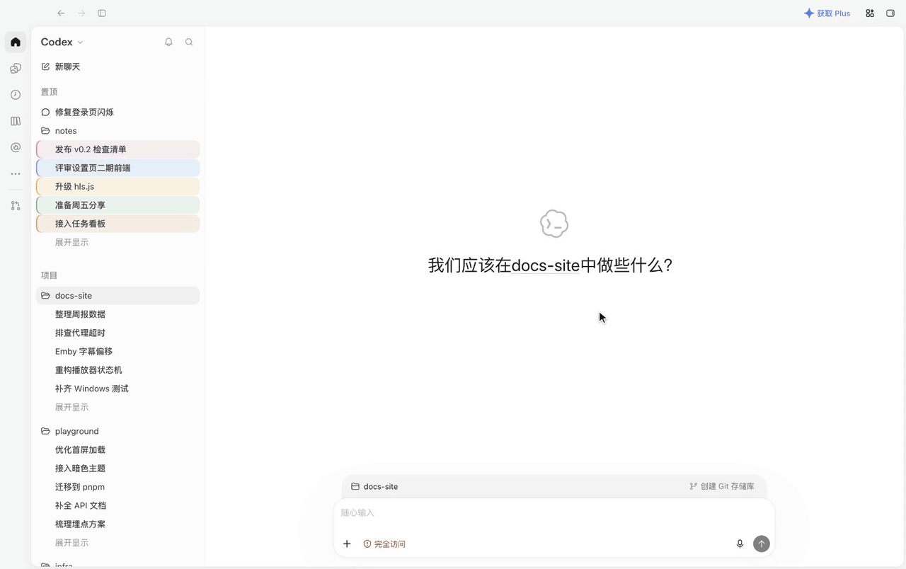
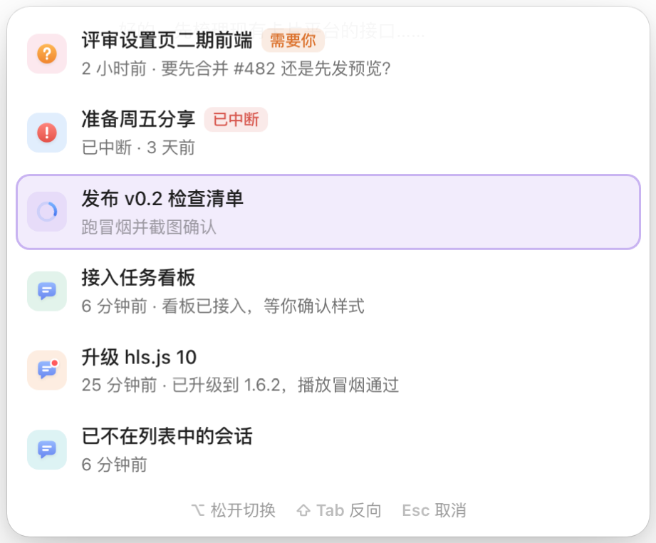
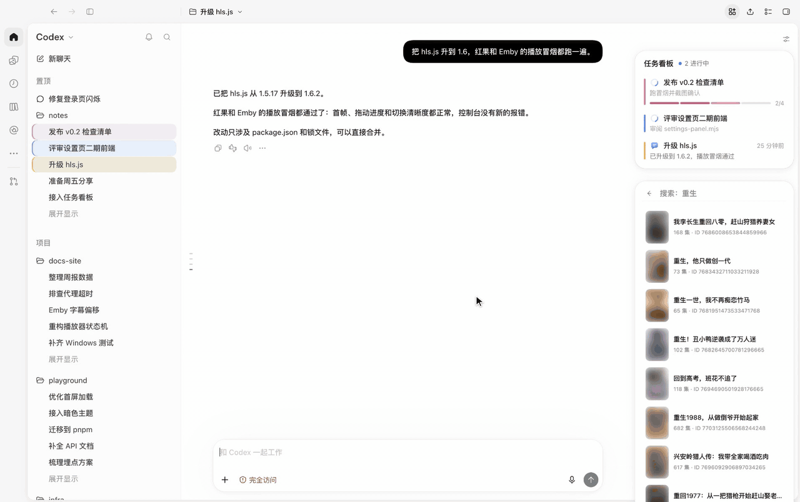

# Codex Companion

**简体中文** | [English](README.en.md)

Codex Companion 是 Codex 桌面端（macOS / Linux）的卡片平台：在对话旁边提供一块可扩展的卡片区，
并把写卡片这件事交给 AI。一张卡片就是一个目录，约定足够小，你只需要告诉 Codex 想要什么，
它就能按仓库里的约定把卡片写出来，重新安装后出现在对话旁。

平台同时内置了几张开箱即用的卡片：跟踪多个会话进度的任务看板、红果短剧、Emby 播放器和代理状态。

Companion 以后台服务的形式运行，安装一次后日常只需打开 Codex。它不修改 `app.asar`、Codex 安装包或应用签名。

> Codex Companion 是非官方项目，与 OpenAI、ChatGPT、Codex、字节跳动、红果短剧及 Emby 均无隶属、
> 授权或背书关系；相关名称和商标归各自权利人所有。



## 目录

- [特性](#特性)
- [内置卡片](#内置卡片)
- [让 AI 写一张卡片](#让-ai-写一张卡片)
- [安装](#安装)
- [使用说明](#使用说明)
- [工作原理](#工作原理)
- [安全与隐私](#安全与隐私)
- [已知边界](#已知边界)
- [开发](#开发)
- [卸载](#卸载)
- [参与贡献与许可](#参与贡献与许可)

## 特性

- **卡片由 AI 定义**：卡片是 `src/cards/<id>/` 下的一个目录（清单、渲染入口、可选的后台服务）。
  仓库的 `AGENTS.md` 写明了卡片约定，Codex 读完就能独立新增一张卡片。
- **平台负责通用部分**：外框与布局、Shadow DOM 样式隔离、开关与排序、生命周期、本地存档、
  页面与后台之间的 RPC、资源回收，卡片只写自己的界面和逻辑。
- **按能力授权**：卡片在清单里声明需要的能力（存档、后台 RPC、会话列表、顶层浮层），未声明的能力拿不到。
- **内置卡片开箱即用**：任务看板、红果短剧、Emby、代理状态，可分别启停和排序，跟随 Codex 的明暗主题。
- **不改动 Codex**：通过本机回环地址上的调试端口注入界面，后台服务随登录启动，崩溃后自动恢复。

## 内置卡片

| 卡片 | 用途 | 默认 |
|---|---|---|
| **任务看板** | 把正在推进的 Codex 会话钉在一处，实时显示状态、计划进度与单会话 Trace | 开启 |
| **红果短剧** | 浏览、搜索、收藏、选集、播放与自动连播（需要 FFmpeg） | 开启 |
| **Emby** | 连接自建 Emby 服务器：媒体库、搜索、选源、字幕、续播与进度上报 | 开启 |
| **代理状态** | 查看当前 Codex 的启动代理与本机端口连通性 | 开启 |

### 任务看板

同时推进多个 Codex 会话时，不用再逐个点开确认进度。

- **一处看全**：把会话加入看板后，等你回答、已中断、长时间无响应的排在最前，其次是没看过的新回复，进行中的在后。
- **计划进度**：Codex 列了计划时，任务下方显示按步分格的进度条和正在做的那一步。
- **单会话 Trace**：鼠标停在任务上，弹出这个会话的时间线，按计划、模型、命令、文件、子代理和你分道展示，
  失败与等待输入的片段单独标出。
- **快速切换**：macOS 上按住 Option 连按 Tab，像 ⌘Tab 一样在看板会话之间切换。
- **边看边等**：在卡片里看视频时，任务需要你就自动暂停并提醒，完成了弹个提醒，全屏也看得到。




### 红果短剧

在卡片里浏览推荐、搜索剧集、维护片单，选集播放并自动连播下一集，多季作品可切换季。
卡片通过非官方 SDK [openhongguo](https://github.com/beilunyang/openhongguo) 读取内容，播放需要本机安装 FFmpeg。
使用前请阅读[红果短剧的使用说明](#红果短剧-1)中关于播放方式与合规的部分。

边看边等：看板上的任务需要你时，视频自动暂停并弹出提醒，点「去处理」直接打开对应会话（演示中海报与画面做了模糊处理）。



### Emby

连接自建的 Emby 服务器，在对话旁边继续看片：多服务器、媒体库、继续观看、最近添加、搜索、选季选集、
选源、字幕和进度上报。能直接播放的格式直接播放，HEVC、杜比视界、图形字幕等交给本机 FFmpeg 处理。

## 让 AI 写一张卡片

卡片平台的设计目标是让 AI 能独立完成一张卡片。在仓库目录里打开 Codex，直接描述需求即可，例如：

```text
给 Companion 加一张「番茄钟」卡片：25 分钟专注、5 分钟休息，可以开始、暂停和重置，
记住今天完成了几个番茄。按 AGENTS.md 里的卡片约定来做。
```

Codex 会按约定完成这些步骤，你也可以手动执行：

```sh
npm run card:create -- pomodoro --title 番茄钟      # 生成卡片骨架；需要后台服务时加 --service
# 编辑 src/cards/pomodoro/ 下的文件
npm start                                           # 重新生成并重启后台服务
```

新卡片默认关闭，在卡片区的设置（齿轮）里启用后即可看到。

一张卡片由这些文件组成：

| 文件 | 作用 |
|---|---|
| `manifest.json` | 卡片清单：`id`、标题、默认开关与顺序、布局、生命周期、存档范围、所需能力 |
| `renderer.mjs` | 页面入口，导出 `mount(ctx)`，在平台给的 ShadowRoot 里渲染界面 |
| `service.mjs` | 可选的后台服务，导出 `createService()`，方法以 `<卡片 id>.<方法名>` 暴露给本卡片 |

清单里可以声明的能力：

| 能力 | 说明 |
|---|---|
| `storage` | 带版本与校验的本地存档 |
| `rpc` | 调用本卡片的后台服务；请求自动带上卡片命名空间，卡片卸载时自动取消 |
| `threads` | 读取 Codex 侧栏的会话列表并定位、打开会话 |
| `overlay` | 在卡片区之外显示顶层浮层 |

完整约定见 [AGENTS.md](AGENTS.md) 的「新增卡片」一节。卡片随仓库一起构建，不会在运行时加载外部代码。

## 安装

### 平台支持

| 平台 | 加载方式 | 数据目录 |
|---|---|---|
| macOS（Apple Silicon / Intel） | 后台服务识别刚打开的 Codex，安全退出后带调试参数重开 | `~/Library/Application Support/codex-companion/` |
| Linux（预览，x64 / ARM64） | 覆盖应用菜单里的 ChatGPT 入口，打开时直接带上调试参数，不需要重开 | `~/.config/codex-companion/` |

Linux 版为预览：已验证安装、启动、连接、注入与 RPC，登录后会话界面里的卡片位置尚未在 Linux 上验证。Windows 暂不支持。

### 系统要求

- macOS 上的 Codex 桌面端，或 Linux 上官方 deb / rpm 安装的 ChatGPT 桌面版
  （`/usr/lib/chatgpt/ChatGPT`，其它位置用 `CODEX_COMPANION_CODEX_EXECUTABLE` 指定）。
- 从源码安装需要 git、Node.js 22+ 与 npm（依赖安装会提供固定版本的 Bun）；用 Homebrew 安装只需要
  Homebrew，Node.js 与 FFmpeg 由它装上。
- macOS 需要 Xcode Command Line Tools（`xcode-select --install`），用来编译识别并重开 Codex 的原生助手。
- Linux 需要 systemd 用户服务（`systemctl --user`）；可选 `notify-send`（libnotify）用于提示重开，
  `secret-tool`（libsecret）用于保存 Emby Token，缺少时 Token 存到数据目录下 `0600` 的文件。
- **FFmpeg**：红果短剧必须有它才能播放；Emby 的 HEVC、EC-3、MKV、超高码率媒体和图形字幕也要用。
  Emby HLS、常规 MP4 与其它卡片不需要。项目不打包 FFmpeg，只查找 `CODEX_COMPANION_FFMPEG`、`PATH`
  与 Homebrew / MacPorts（Linux 另含 `/usr/bin`、snap、Linuxbrew）目录。

macOS 上的杜比视界 / HDR 本机播放需要 `brew install ffmpeg-full molten-vk`；
P5/P8 使用 RPU 映射到 BT.709 SDR，HDR10/HLG 做色调映射，这不是原生 HDR 输出。

### 用 Homebrew 安装（macOS）

```sh
brew tap foriLLL/codex-companion https://github.com/foriLLL/codex_companion
brew trust --formula foriLLL/codex-companion/codex-companion
brew install --HEAD codex-companion
codex-companion agent install
```

Homebrew 7 起第三方 tap 里的 Formula 要先信任才会加载，第二条命令只信任这一个 Formula。
Homebrew 自动装好 Node.js 与 FFmpeg，在本机生成卡片渲染器并编译原生助手；最后一条命令注册登录后自动启动的
后台服务。装好后重新打开 Codex 即可看到卡片。

仓库还没有打版本 tag，所以要加 `--HEAD`，装的是 main 分支的最新代码。更新：

```sh
brew upgrade --fetch-HEAD codex-companion && codex-companion agent install
```

后台服务记的是 Homebrew 的固定路径，Homebrew 升级 Node.js 不影响它；升级 Companion 后由第二条命令换上新版本。
Homebrew 安装与源码安装共用同一个后台服务和数据目录，二者装一个即可，以最后执行 `agent install` 的为准。

### 从源码安装

```sh
git clone https://github.com/foriLLL/codex_companion.git
cd codex_companion
npm ci
npm start
```

`npm start` 一次完成以下步骤：

1. 生成卡片渲染器。
2. macOS 上编译原生助手；缺少 Command Line Tools 时会停下并提示先运行 `xcode-select --install`。
3. 检查 FFmpeg。macOS 上没有 FFmpeg 但有 Homebrew 时自动执行 `brew install ffmpeg`
   （设置 `CODEX_COMPANION_SKIP_FFMPEG=1` 可跳过）；其余情况只提示，需要自行安装：

   | 系统 | 命令 |
   |---|---|
   | macOS | 先安装 [Homebrew](https://brew.sh/)，再运行 `brew install ffmpeg` |
   | Debian / Ubuntu | `sudo apt install ffmpeg` |
   | Fedora | `sudo dnf install ffmpeg-free` |

   FFmpeg 可以之后再补装，不用重新安装 Companion。
4. 以当前源码注册登录后自动启动的后台服务（macOS：launchd；Linux：systemd 用户服务并覆盖菜单入口）。

装好后重新打开 Codex 即可看到卡片。后台服务直接运行当前 Node 与这个仓库目录里的源码，**装好后不要删除或移动
仓库**（移动后要重新执行 `npm start`）。更新时在仓库里执行 `git pull && npm ci && npm start`；用 nvm、fnm 等
切换 Node 版本后也要重新执行 `npm start`。

### 发布版（尚未发布）

仓库还没有 GitHub Release，下面的命令暂时不可用；发布后可以不装 Node.js 直接安装：

```sh
curl -fsSL https://github.com/foriLLL/codex_companion/releases/latest/download/install.sh | bash
```

macOS 上，安装器下载经 Developer ID 签名与 Apple 公证的 `Codex Companion.app`，校验后安装到
`~/Applications` 并打开引导；在引导中点击「启用自动加载」，注册登录后自动启动的
后台服务（如需批准，前往「系统设置 › 通用 › 登录项」）。已有 Homebrew 时会补装 FFmpeg。

Linux 上先安装官方 ChatGPT 桌面版，再运行同一条命令。安装器下载与脚本同版本的单文件后端，
按发布时写入脚本的 SHA256 校验后放到 `~/.local/share/codex-companion`，注册 systemd 用户服务
并覆盖应用菜单里的 ChatGPT 入口，不需要 sudo。之后从应用菜单打开 ChatGPT 即可；安装时
ChatGPT 若已开着，需要退出后从菜单重开一次。FFmpeg 需自行安装。

### Linux 安装写入的文件

安装会写入两个文件：`~/.config/systemd/user/codex-companion-agent.service`，以及与系统同名的
`~/.local/share/applications/chatgpt.desktop`。后者只把启动命令换成 Companion 的入口，
名称、图标和 `codex://` 等协议关联保持不变。如果这个位置已有你自己的同名文件，安装会停下，不会覆盖。

### 首次打开

**macOS**：后台服务（launchd `com.codexcompanion.agent`）在 Codex 刚启动（8 秒内）且位于前台时，
请求它正常退出，再以 `--remote-debugging-address=127.0.0.1` 和随机端口重开并注入卡片；
打开后立刻点击或输入也照常重开。启动更久的 Codex 不会被自动退出，只提示需要重开；
两次自动重开至少间隔两分钟。

注入后 Codex 顶栏出现 Companion 入口，点开即显示卡片；设置（卡片区齿轮）里可以改为
排在原生摘要下方。后台服务崩溃后由 launchd 自动拉起，并重新连接已开启调试端口的 Codex。

**Linux**：从应用菜单打开 ChatGPT 即可。入口以 `--remote-debugging-address=127.0.0.1` 和随机端口
启动它，常驻服务发现后连接并注入。在终端直接运行 `chatgpt`、或安装时 ChatGPT 已经开着，
都不会带调试参数，此时会提示退出后从应用菜单重新打开。Companion 不会在 Linux 上自动退出或重启 ChatGPT，
修改启动代理后同样需要手动从菜单重开。

## 使用说明

- 在设置中调整卡片开关与顺序；关闭卡片保留存档。
- 「Codex 启动代理」保存启动偏好后，点击「保存并重启」应用。
- 收起卡片保留页面状态；关闭页面、取消请求或后台退出时回收媒体会话、Blob URL、分片缓存与转码进程。

### 任务看板

- 打开一个会话后点「加入当前会话」，它会一直留在看板上，左侧侧栏对应条目也会标上
  同样的颜色；做完点 ✓ 移出，几秒内可以撤销。最多保留 100 个任务。
- 状态图标实时更新：等你回答、已中断、超过 15 分钟无响应排在最前，其次是没看过的新回复，进行中的放在后面；
  回合结束后没看过的会提醒。点击任务在左侧定位并打开对应会话。
- 名字默认跟随 Codex 的会话标题，可以改成自己的叫法（只改看板，不改 Codex）；颜色可以单独调整。
- 鼠标在任务上停一会儿，看板左侧会弹出这个会话的 Trace：按模型、命令、文件、子代理和你分道展示
  时间线，失败与等待你输入的片段单独标出；鼠标移进面板可滚动和缩放，按 Esc 关闭。
- macOS 上按住 Option 连按 Tab，窗口中间弹出看板会话列表（最近打开的在前），松开 Option 切过去；
  快速点一下直接回到上一个会话。Shift+Tab 或方向键反向，Esc 取消，也可以用鼠标点选。
  卡片收起时同样可用；看板为空时不拦截按键。设置的「任务看板」里可以关闭。
  Linux 桌面环境自己占用 Alt+Tab，暂不提供。
- 卡片里有视频在播时（红果、Emby 等），看板任务等你回答、中断或长时间没动静，会暂停播放并在视频旁弹出提醒；
  回合完成只提醒，几秒后自动收起。全屏时提醒盖在画面上；点「去处理」退出全屏并打开对应会话，
  点「继续播放」接着看。设置的「任务看板」里，「任务需要你时」和「任务完成时」可分别选关、提醒或暂停。
  没在播放时不弹，第一次加载也不补发旧变化。

**计划进度**

- Codex 用计划工具（`update_plan`）或专用进度消息（`companion-plan`）列了步骤时，任务下方出现按步分格的进度条和完成数，
  进行中的任务第二行显示正在做的那一步；Trace 里多一个「计划」区（每步状态与用时）和「计划」泳道。
  没列计划时，Trace 按 Codex 干活途中的进度说明列出做过的阶段。
- 当前会话没有 `update_plan` 时也能报告计划：在助手进度消息（`commentary`）中输出一个 `companion-plan`
  代码块，内容为完整 JSON 快照，例如 `{"plan":[{"step":"检查现状","status":"completed"},{"step":"验证结果","status":"in_progress"}]}`。
  代码块前后可以附带进度说明，只接受一个完整的非引用、非嵌套计划块；不把用户消息、工具输出或最终回复当作计划。
  `companion-plan` 标记专用于真实进度报告，协议示例应使用普通 `json` 代码块，避免把示例当作当前进度；
  状态只能是 `pending`、`in_progress`、`completed`，最多一个进行中步骤。没有快照就不猜总体完成比例。

**长任务先列计划**

这个开关默认关闭。开启时先显示修改全局指令的确认提示，可展开查看将追加的完整规则；
只有点击「同意修改并开启」才保存开启配置，取消或关闭设置不会启用。

确认后会在 Codex 的全局指令文件（`~/.codex/AGENTS.md`；`AGENTS.override.md` 非空时写在它里面）
末尾加一段带标记的提示，要求预计 3 步以上或超过 5 分钟的任务先列计划、每完成一步就更新。
这段提示会进入模型上下文，影响所有新会话，不限于当前项目或看板中的任务；不改写用户输入，
也不保证任务完成正确。它仅用于让看板取得结构化步骤进度，不开启 Plan Mode，也不改变权限。
只增删标记之间的内容，关闭开关、停用任务看板或卸载 Companion 时删除；已加载规则的会话不会自动撤回。

### 红果短剧

卡片通过 [openhongguo](https://github.com/beilunyang/openhongguo) 这个非官方 SDK 读取
红果的公开目录与播放地址；SDK 以 wasm 形式随应用分发，不需要另外安装。SDK 用本机生成的
匿名设备档案请求内容，不接受登录态。

**播放方式**：后台把签名 URL 直接交给本机 FFmpeg（没有 FFmpeg 就无法播放，安装见[安装](#安装)），
以 `-decryption_key` 解出受内容密钥保护的流，转成 H.264/AAC fMP4 后经有界 RPC 分片交给页面 MSE 播放；
源编码是 HEVC 时统一转码，避免 Chromium 解码不稳定。也就是说，受保护的剧集是用 SDK 取得的
内容密钥在本机解密后播放的，并非红果官方提供的播放方式；播放期间签名地址与内容密钥会出现在
FFmpeg 的命令行参数里，本机同一用户的其他进程可以看到。

**浏览与连播**：搜索限定「剧集」分类并支持继续分页，缺失的封面由 SDK 批量详情补齐；多季作品的选集页可切换季。
本集结束后立即自动播放下一集；最后一集保留重播入口。推荐加载失败只显示局部提示，不阻止搜索或片单播放；
离开首页后推荐请求与后台重试会取消。Codex 窗口隐藏时不计 MediaSource 启动超时，回到窗口后继续启动；
取消播放仍立即释放等待资源。

**限制**：红果只按匿名设备放行播放，请求被限流时会自动更换设备重试，因此播放额度按设备计算。
卡片只显示 SDK 能拿到地址的剧集；内容下架、需要登录或要求验证时会直接报错。

**合规**：内容与访问规则可能随时变化，这张卡片也可能随之失效。使用者应自行确认所在地法律、
站点条款及内容权利允许相应访问；本项目不提供、托管或授权任何视频内容。

### Emby

首次打开卡片时输入服务器地址、用户名和密码。数据目录中的 `emby.json`（`0600`）
只保存服务器地址与标识、UserId、用户名与 DeviceId；每个 AccessToken 单独存入
系统凭证库（service 为 `codex-companion.emby`），密码不会落盘。

有多个媒体版本时，手动选择始终优先；默认保留字幕与最高分辨率档，再优先逐行源，
并估算输入、转码输出和页面解码的成本。播放路径：

1. 服务端允许转码时使用 H.264/AAC HLS。
2. 兼容的 H.264/AAC MP4 经 CDP 媒体拦截原生播放，或经 MP4Box 分段，通过有界 RPC 分片和 MSE 播放。
3. 超高码率 MP4、HEVC、EC-3、多音轨、其他容器或图形字幕烧录交给本机 FFmpeg，
   输出 H.264/AAC fMP4。

SRT、WebVTT、ASS 和 SSA 等文字字幕由播放器单独渲染（ASS/SSA 在本机转换为
WebVTT），不会仅为显示文字而重新编码视频；PGS、VobSub、DVB 等图形字幕需要烧录。
需要本机处理但没有 FFmpeg 时，界面会提示安装或指定 FFmpeg。

连接前可以运行只读探针（密码在终端无回显输入，不写配置或凭证库）：

```sh
npm run probe:emby -- --server https://emby.example.com --username alice --search 三体
```

## 工作原理

1. 常驻的后台服务（macOS 上经原生助手）观察 Codex 启动，在安全条件下以 loopback
   随机调试端口重开 Codex，再通过 CDP 注入卡片渲染器。
2. 页面经 CDP binding 与后台 RPC 通信，只有顶层页面的调用会被处理；各卡片共用渲染器、
   服务注册表与生命周期管理。
3. 后台访问红果、Emby 和允许的媒体 CDN；页面不直接接触凭证。
4. 媒体经 127.0.0.1 本地代理（HLS）、CDP 媒体拦截或有界 RPC 分片 + MSE 播放；
   每次响应、后台队列、分片缓存与页面缓冲都有上限。
5. 返回、seek、切集、登出或关闭页面会取消对应请求并回收资源；心跳超时也会触发回收。

注入依赖 Codex 的 DOM 结构，Codex 改版后可能需要更新。日志位于
`~/Library/Logs/codex-companion/agent.log`（Linux：`journalctl --user -u codex-companion-agent`），
`node src/cli.mjs agent status` 输出状态。

## 安全与隐私

- **调试端口**：CDP 调试端口强制绑定 loopback 和随机端口，禁止暴露到局域网或公网。
- **卡片隔离**：卡片、请求代次和媒体分片相互绑定，关闭或禁用卡片后不能继续读取旧分片。
- **Emby 凭证**：Token 只发往配置的 Emby origin，不进入 DOM、媒体 URL、FFmpeg 命令行或日志。
- **媒体地址**：跨源媒体 CDN 必须使用 HTTPS，并经过地址、DNS 和公网 IP 校验。
- **依赖**：版本由 `package-lock.json` 固定，运行时不加载 CDN 脚本。
- **红果**：匿名设备档案保存在数据目录的 `hongguo/anonymous.json`，供后续请求复用。
  封面只允许已加载内容中的红果 CDN HTTPS 地址，每次连接校验并固定公网 IP，重定向逐跳验证；
  片单输入不能添加未知封面地址。签名播放地址与内容密钥在播放期间会出现在 FFmpeg 命令行参数里。
- **任务看板**：只读本机 Codex 数据目录（`~/.codex`，或 `CODEX_HOME`）下的会话记录、
  `session_index.jsonl` 与 `.codex-global-state.json`，不上传；唯一的写入是你打开
  「长任务先列计划」后对 `AGENTS.md` 那一段带标记的提示。看板自身的任务列表保存在数据目录下的 `task-board.json`。

安全问题请按 [SECURITY.md](SECURITY.md) 私下报告，不要在公开 issue 中提交 Token、
服务器地址、日志原文或其他隐私信息。

## 已知边界

- 不支持 Emby Connect、服务器自动发现、Live TV、音频库和 DRM；不关闭 TLS 校验，
  不支持自签名 Emby HTTPS。
- 切换到其他卡片时暂停媒体；不支持 Emby 自动连播、在线字幕搜索或字幕时间轴偏移。
- 红果依赖本机 FFmpeg 与 SDK 的匿名设备额度；被限流时首次播放可能重试数秒，
  播放失败需要重新选集。
- 已经在使用、未带调试参数的 Codex 需要手动重开一次才能注入。
- Linux 为预览：登录后会话界面中的卡片位置尚未验证；Windows 暂不支持。
- 任务看板的状态由 Codex 本地会话记录推断，依赖其记录格式与侧栏 DOM，Codex 改版后
  可能需要更新。
- 卡片抽屉推开对话流的方式优先复用 Codex 原生 Summary 的布局；Codex 升级改掉内部结构后会自动换成
  不依赖内部命名的方式（观感接近，但不保证与 Summary 完全一致）。升级后可运行 `npm run check:host`
  查看是否降级。
- 界面目前只有中文。

## 开发

```sh
npm test                                        # 必须使用 Node 内置测试运行器
npm run smoke                                   # Chromium 冒烟
npm run check:host                              # Codex 升级后自检：各项适配是否降级（只读）
node scripts/smoke-plan-messages.mjs             # 无计划工具的动态进度与 Trace 冒烟
npm run card:create -- my-card --title 我的卡片  # 新建卡片骨架
node src/cli.mjs agent                          # 前台运行后台服务
node scripts/build-native.mjs                   # 编译原生助手
npm run build:app                               # 构建 Codex Companion.app
npm run build:linux -- --target linux-x64       # 构建 Linux 单文件后端
npm run start:legacy                            # 旧一次性 CDP 启动与注入
```

开发约定见 [AGENTS.md](AGENTS.md) 与 [CONTRIBUTING.md](CONTRIBUTING.md)。

## 卸载

用 Homebrew 安装的，先运行 `codex-companion agent uninstall` 停用后台服务，再执行
`brew uninstall codex-companion && brew untap foriLLL/codex-companion`。

从源码安装的，在仓库里运行 `node src/cli.mjs agent uninstall`（停用后台服务；Linux 同时删除 Companion
生成的菜单入口，系统原有入口随之恢复），再删除仓库目录。发布版在 `Codex Companion.app` 中点击
「卸载 Companion」再删除 App，或运行 `bash install.sh --uninstall`。

如需同时清除配置与存档，手动删除上文的数据目录；Emby Token 位于「钥匙串访问」
（service 为 `codex-companion.emby`）。删除不可恢复。

## 参与贡献与许可

开发流程见 [CONTRIBUTING.md](CONTRIBUTING.md)，版本变化见 [CHANGELOG.md](CHANGELOG.md)，
第三方组件见 [THIRD_PARTY_NOTICES.md](THIRD_PARTY_NOTICES.md)。项目源码采用
[MIT License](LICENSE)。
