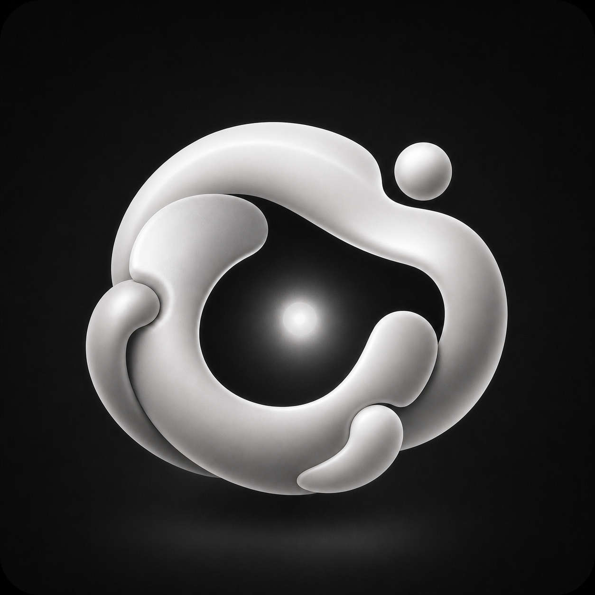
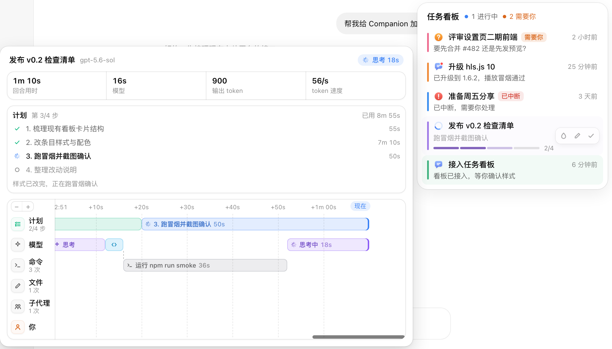
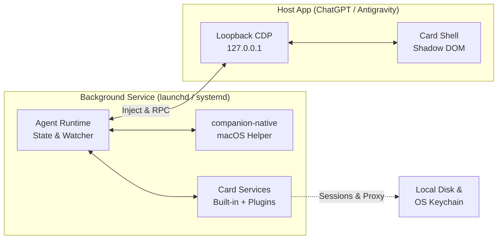

<div align="center">



# Agent Companion

**An extensible card & plugin workbench for AI coding desktop apps.**

Multi-session task board, live execution traces, model quota, and hot-reloadable card plugins<br/>
for **ChatGPT** and **Antigravity** — without patching app binaries or breaking signatures.

<p>
  <a href="https://github.com/foriLLL/agent-companion/releases/latest"></a>
  <a href="https://github.com/foriLLL/agent-companion/actions/workflows/ci.yml"></a>
  
  <a href="LICENSE"></a>
  <a href="https://github.com/topics/agent-companion-card"></a>
</p>

**English** · [简体中文](README.zh-CN.md)

[Quick Start](#quick-start) · [Built-in Cards](#built-in-cards) · [Plugin System](#plugin-system) · [Architecture](#architecture) · [Security](#security--privacy)

</div>

<br/>


> **Note:** The injected UI is currently in Simplified Chinese.

---

## Why Agent Companion?

Running multiple AI coding agents in parallel turns desktop apps into a tab-switching tax — checking which agent is waiting for approval, reading where a long turn stalled, watching model quota, or keeping a side utility next to your chat. Closed Electron apps don't let you add panels.

- **Zero-Touch Multi-Host Injection** — Works with **ChatGPT** and **Antigravity** via a resident background service and a loopback-only debugging port. Never modifies `app.asar`, app bundles, or code signatures.
- **Multi-Agent Mission Control** — Pin active sessions onto one prioritized board, inspect multi-lane execution traces (`plan`, `model`, `shell`, `files`, `sub-agents`, `you`), switch sessions with `⌥Tab`, and jump straight to blocked agents with `⌥J`.
- **Everything Is a Plugin** — Built-in cards and community cards share one package format. Install cards from any Git repo with `agent-companion cards install owner/repo` — changes hot-reload in seconds, no rebuild or central store required.
- **AI-Native Extensibility** — The card contract is intentionally tiny (`manifest.json`, `renderer.mjs`, optional `service.mjs`). Describe the panel you want to your coding agent and ship a custom card in minutes.

---

## Supported Hosts & Platforms

| Host | macOS (Apple Silicon / Intel) | Linux (x64 / ARM64) | Windows |
|---|---|---|---|
| **ChatGPT Desktop** | **Supported** — `launchd` agent auto-reopens fresh launches (≤ 30s, foreground or background) with a loopback CDP port | **Preview** — overrides `chatgpt.desktop` menu entry + `systemd --user` service (no auto-quit) | Not yet |
| **Antigravity** | **Preview** — same native auto-reopen on fresh launch & updates (≤ 30s, foreground or background), or `agent-companion antigravity [--restart]` | — | Not yet |

---

## Quick Start

### macOS (Homebrew — Recommended)

```sh
brew tap foriLLL/agent-companion https://github.com/foriLLL/agent-companion
brew trust --formula foriLLL/agent-companion/agent-companion
brew install agent-companion
agent-companion agent install
```

Homebrew installs Node.js and FFmpeg automatically, builds the native macOS helper, and keeps the background service updated on new releases. Reopen **ChatGPT** or **Antigravity** once after installing to load the card workbench.

### From Source (macOS / Linux)

```sh
git clone https://github.com/foriLLL/agent-companion.git
cd agent-companion
npm ci
npm start
```

`npm start` generates card bundles, compiles the macOS native helper (requires Xcode Command Line Tools), checks FFmpeg, and registers the login background service (`launchd` on macOS, `systemd --user` + desktop entry on Linux). Keep the repository in place after installing; update anytime with `git pull && npm ci && npm start`.

<details>
<summary><strong>Requirements, Linux notes &amp; optional FFmpeg / HDR setup</strong></summary>

- **Hosts**: ChatGPT desktop app on macOS (`/Applications/ChatGPT.app`) or official deb/rpm on Linux (`/usr/lib/chatgpt/ChatGPT`, override with `AGENT_COMPANION_CODEX_EXECUTABLE`), and Google Antigravity on macOS (`2.35+`).
- **Source builds**: `git`, Node.js `22+`, npm (pinned Bun is included in devDependencies), and Xcode Command Line Tools (`xcode-select --install`) on macOS.
- **Linux**: requires `systemd --user`; optional `notify-send` (reopen notifications) and `secret-tool` (Emby token storage; falls back to a `0600` file). Writes `~/.config/systemd/user/agent-companion-agent.service` and `~/.local/share/applications/chatgpt.desktop` (refuses to overwrite a custom entry). Always launch from the application menu; `chatgpt` from a terminal will not carry debugging flags.
- **FFmpeg**: required for Hongguo playback and for Emby HEVC, EC-3, MKV, very high-bitrate streams, or image-based subtitles (not required for Task Board, Usage, Proxy, or Emby HLS/compatible MP4). Not bundled; resolved from `AGENT_COMPANION_FFMPEG`, `PATH`, or standard package-manager paths.
  - macOS Dolby Vision (P5/P8 RPU → BT.709 SDR) and HDR10/HLG tone-mapping require `brew install ffmpeg-full molten-vk`.
- **Data directories**: `~/Library/Application Support/agent-companion/` (macOS) · `~/.config/agent-companion/` (Linux).
- **Disable Antigravity host**: set `AGENT_COMPANION_ANTIGRAVITY=0`.

</details>

<details>
<summary><strong>Manual upgrades &amp; migrating from Codex Companion / &lt; 0.2.0</strong></summary>

- **Manual Homebrew upgrade**:
  ```sh
  brew upgrade agent-companion && agent-companion agent install
  ```
- **Upgrading from `< 0.2.0` or from the old `Codex Companion` name (pre-0.4.0)**:
  Homebrew 7 tracks trust per formula name, so run the migration helper once (or run `brew trust --formula foriLLL/codex-companion/agent-companion` and click update in Settings):
  ```sh
  curl -fsSL https://raw.githubusercontent.com/foriLLL/agent-companion/main/scripts/upgrade.sh | bash
  ```
  On first start, the new version automatically moves the data directory (leaving a symlink behind), hands off `com.codexcompanion.agent` → `com.agentcompanion.agent`, and preserves Emby credentials, card storage, plan-hint blocks, and `CODEX_COMPANION_*` environment variables.

</details>

---

## Built-in Cards

All five built-in cards are packaged using the exact same plugin format as third-party cards and can be toggled or reordered in Companion Settings (the gear icon inside the card panel).

| Card | Purpose | Hosts | Default |
|---|---|---|---|
| **Task Board** | Pin parallel sessions, see live status & plan progress, inspect multi-lane Traces, switch with `⌥Tab` / `⌥J` | ChatGPT, Antigravity | On |
| **Usage** | Model quota & reset countdowns — compact progress bars for ChatGPT (`codex app-server`), 4-ring groups for Antigravity (Gemini + Claude/GPT) | ChatGPT, Antigravity | Off |
| **Proxy Status** | Compact single-line indicator for ChatGPT launch proxy & loopback port health | ChatGPT | On |
| **Hongguo** | Browse, search, watchlist, season/episode picker & auto-play short dramas (requires FFmpeg) | ChatGPT, Antigravity | On |
| **Emby** | Multi-server self-hosted Emby client: libraries, resume, source/subtitle picker & progress reporting | ChatGPT, Antigravity | On |

### Task Board & Live Trace

Keep an eye on every running agent without clicking through conversations one by one:

- **Attention-first sorting** — Sessions waiting for input/approval, interrupted, or idle > 15 min float to the top, followed by unread replies and active runs. Sidebar rows mirror each task's color.
- **Multi-lane Execution Trace** — Hover any task to open a zoomable timeline split by `plan`, `model`, `shell`, `files`, `sub-agents`, and `you`. Concurrent tool calls automatically pack into separate sub-rows so labels never overlap.
- **Keyboard-first switching (macOS)** — Hold `⌥` + `Tab` for an MRU task switcher (works even when the panel is collapsed, supports `1–9`, `W` to archive, `Z` to undo); press `⌥J` to jump straight to the next session that needs you.
- **Optional Plan Progress & Auto-Add** — Displays segmented step progress when ChatGPT uses `update_plan` or structured progress snapshots, and can auto-add new desktop conversations.




### Host-Native Integration (ChatGPT & Antigravity)

- **ChatGPT** — Native top-bar icon that matches official toolbar icon color and stroke weight; cards open in a collapsible drawer or docked inline below ChatGPT's native Summary panel.
- **Antigravity** — Top-bar icon anchored beside the Overview toggle (falling back seamlessly to the top-right titlebar `⋮` on New Conversation pages), opening a frameless frosted-glass popover (`⌥⌘J`) with feathered edges so underlying chat text stays readable on narrow screens.

### Watch While You Wait

Long agent turns take minutes. When video is playing in **Hongguo** or **Emby** (even in fullscreen), Companion automatically pauses playback and shows an alert the moment a task on your board needs approval or input — click **去处理** (or press `⌥J`) to exit fullscreen and jump straight to that session.


<details>
<summary><strong>Deep dive: Task Board shortcuts, plan-first rules &amp; Antigravity data source</strong></summary>

- **Shortcuts**: Option (`⌥Tab` / `⌥J`) can be switched to Control (`⌃Tab` / `⌃J`) or disabled in Task Board settings; you can also include recent non-board conversations in the switcher.
- **Plan first for long tasks** (ChatGPT, off by default, explicit confirmation required): appends a marked block to `~/.codex/AGENTS.md` (or non-empty `AGENTS.override.md`) and a marked `[tools.update_plan] enabled = true` entry to `~/.codex/config.toml` (skipped if you already configured `update_plan`). Cleanly removed when turned off or uninstalled.
- **Antigravity sessions**: reads `~/.gemini/antigravity/` conversation summary database and step logs read-only; stores its board separately in `task-board-antigravity.json`. Auto-add only tracks GUI conversations, not `agy` CLI sessions.

</details>

<details>
<summary><strong>Deep dive: Emby playback paths &amp; Hongguo notes / compliance</strong></summary>

- **Emby**: `emby.json` (`0600`) stores server/user metadata; each `AccessToken` is stored in the OS credential store (`agent-companion.emby`); passwords never touch disk. Playback prefers H.264/AAC HLS when allowed, native MP4 via CDP media interception or MP4Box/MSE, and local FFmpeg for HEVC, EC-3, high-bitrate streams, or burned-in PGS/VobSub/DVB subtitles (SRT/WebVTT/ASS/SSA render natively without re-encoding). Probe a server read-only before connecting: `npm run probe:emby -- --server https://emby.example.com --username alice --search "three body"`.
- **Hongguo**: fetches public listings and streams via the bundled [openhongguo](https://github.com/beilunyang/openhongguo) wasm SDK using a local anonymous device profile (`hongguo/anonymous.json`) and decrypts/remuxes through local FFmpeg (`-decryption_key` and signed URLs appear in FFmpeg's process arguments during playback). This is not an official playback path; rules or availability may change at any time. Confirm local laws, terms of service, and content rights before use — this project does not host or license any media.

</details>

---

## Plugin System

Agent Companion uses a decentralized plugin model inspired by Vim and Zsh — no central marketplace, no review queue, and no rebuild step.

### Install Community Cards

Browse shared cards on GitHub under the topic [`agent-companion-card`](https://github.com/topics/agent-companion-card):

```sh
agent-companion cards install owner/agent-companion-card-pomodoro        # GitHub owner/repo
agent-companion cards install owner/agent-companion-card-pomodoro@v1.0.0 # pin to tag, branch, or commit
agent-companion cards install ./my-local-card                            # install from a local folder
agent-companion cards list                                               # inspect enabled / disabled / failed cards
agent-companion cards update                                             # update unpinned cards
agent-companion cards remove <id> [--purge]                              # uninstall (--purge deletes card data)
```

Newly installed cards start **disabled by default** — enable them in Companion Settings, where you can also uninstall user-installed cards directly under the **Plugins** section (with an option to delete saved card data). Changes take effect within seconds while the background service is running.

### Let Your AI Build a Card

Open **ChatGPT** or **Antigravity** and describe what you want:

```text
Create an Agent Companion card plugin named "pomodoro": 25 min focus, 5 min break,
start/pause/reset controls, and daily completed count persisted in card storage.
Follow cards/README.md.
```

Or scaffold and iterate manually:

```sh
agent-companion cards create pomodoro --title "Pomodoro"   # add --service for a Node backend
cd pomodoro                                                # edit renderer.mjs (and service.mjs)
agent-companion cards build                                # bundle UI → renderer.js
agent-companion cards link .                               # symlink into cards dir; rebuilds hot-reload
```

### Package Contract & Capabilities

| File | Required | Role |
|---|---|---|
| `manifest.json` | Yes | Card metadata (`id`, `title`, `apiVersion`, `layout`, `lifecycle`, `state`, `capabilities`, optional `hosts`) |
| `renderer.mjs` → `renderer.js` | Yes | UI entry exporting `mount(ctx)` (and optional `settings(kit)`), rendered inside an isolated `ShadowRoot` |
| `service.mjs` | No | Optional backend exporting `createService(api)`; methods are exposed as `<card-id>.<method>` |

A card only receives the capabilities it explicitly declares in `manifest.json`:

| Capability | Access Granted |
|---|---|
| `storage` | Versioned, schema-validated persistence (`target`, `session`, or backend-writable `global`) |
| `rpc` | Namespaced RPC calls to the card's own `service.mjs`, auto-cancelled on unmount |
| `threads` | Read host sessions, highlight sidebar rows, and open/reveal conversations |
| `overlay` | Render top-level popovers outside the card frame (used by Trace and the `⌥Tab` switcher) |
| `attention` | Emit media-aware alerts that can automatically pause active playback across cards |
| `host` | Read host metadata (`codex` \| `antigravity`) and host-provided APIs (e.g., Antigravity model quota) |

Full authoring & packaging specification: **[cards/README.md](cards/README.md)** · **[AGENTS.md](AGENTS.md)**.

---

## Architecture



- **Safe auto-reopen (macOS)**: `companion-native` observes app launches via `NSWorkspace` and only requests a graceful `NSRunningApplication.terminate()` for fresh single instances within 30 seconds of launch (foreground or background; never `SIGKILL`), then reopens with a random loopback debugging port (using `--background` for background launches). Already-running baseline sessions and previously handled instances are persisted in `runtime.json` and never interrupted.
- **Adaptive host DOM integration**: Entry buttons and layout hooks degrade gracefully across host UI updates; run `npm run check:host` after a ChatGPT update to inspect adapter tiers.
- **Automatic updates**: Homebrew installations check GitHub Releases every 6 hours and upgrade the background service without restarting ChatGPT or Antigravity (deferring restarts while media is playing).

---

## Security & Privacy

- **Loopback-only CDP**: Remote debugging binds exclusively to `127.0.0.1` on an ephemeral random port — never `0.0.0.0`.
- **Plugin trust model**: User-installed card plugins run with your user permissions without a sandbox and are neither reviewed nor signed by Agent Companion. Only install trusted repos and pin `@tag` for stability. **Disabled cards run zero code** (neither UI nor backend is loaded until enabled).
- **Credential isolation**: Emby tokens are stored in the OS credential store (`agent-companion.emby`) and sent only to the configured Emby origin — never exposed to DOM, media URLs, FFmpeg args, or logs.
- **Zero telemetry**: Session logs (`~/.codex`, `~/.gemini/antigravity`) are read locally and never uploaded. Update checks request only GitHub Releases with User-Agent `agent-companion/<version>`.
- **Pinned dependencies & strict media guards**: Runtime loads zero remote CDN scripts; remote media CDNs require HTTPS with DNS and public-IP pinning.
- **Known exception**: Hongguo playback passes signed URLs and decryption keys via local FFmpeg arguments, which are visible to other processes owned by the same OS user during playback.

Please report vulnerabilities privately via **[SECURITY.md](SECURITY.md)**.

---

## Known Limitations

- The card UI is currently in **Simplified Chinese only**.
- **Linux** is a preview (logged-in session layout is unverified); **Windows** is not supported yet.
- **Antigravity** is a macOS preview; its task board decodes the local protobuf summary database and may need updates when Antigravity changes its schema.
- Host apps already running without debugging flags before installation need one manual reopen (or `agent-companion antigravity --restart`).
- Emby does not support Emby Connect, Live TV, audio libraries, DRM, or self-signed HTTPS certificates.
- Host DOM updates may occasionally degrade layout placement until adapted (`npm run check:host`).

---

## Development & Uninstalling

<details>
<summary><strong>Development commands</strong></summary>

```sh
npm test                                         # run full Node built-in test suite (do not use bun test)
npm run smoke                                    # Chromium smoke tests
node scripts/smoke-codex-adapter.mjs             # ChatGPT adapter tier smoke tests
node scripts/smoke-antigravity-adapter.mjs       # Antigravity adapter tier smoke tests
npm run check:host                               # read-only ChatGPT host compatibility check
npm run card:create -- my-card --title "My Card" # scaffold a built-in card
node src/cli.mjs agent                           # run background service in the foreground
node scripts/build-native.mjs                    # rebuild macOS native helper
npm run release -- X.Y.Z                         # bump version, roll CHANGELOG, commit & tag (no push)
```

See [AGENTS.md](AGENTS.md) and [CONTRIBUTING.md](CONTRIBUTING.md) for architecture rules and commit conventions.

</details>

<details>
<summary><strong>Uninstalling</strong></summary>

- **Homebrew**:
  ```sh
  agent-companion agent uninstall
  brew uninstall agent-companion && brew untap foriLLL/agent-companion
  ```
- **From source**:
  ```sh
  node src/cli.mjs agent uninstall
  ```
  Then delete the cloned repository directory.
- **Clean up saved data (optional, irreversible)**: delete `~/Library/Application Support/agent-companion/` (macOS) or `~/.config/agent-companion/` (Linux), and remove `agent-companion.emby` from Keychain Access.

</details>

---

## Contributing & License

Contributions are welcome — see [CONTRIBUTING.md](CONTRIBUTING.md), [CHANGELOG.md](CHANGELOG.md), and [THIRD_PARTY_NOTICES.md](THIRD_PARTY_NOTICES.md).

Released under the [MIT License](LICENSE).

---

<sub><strong>Disclaimer:</strong> Agent Companion is an independent, unofficial project. It is not affiliated with, authorized by, or endorsed by OpenAI, ChatGPT, Codex, Google, Antigravity, ByteDance, Hongguo, or Emby. All product names and trademarks belong to their respective owners.</sub>
