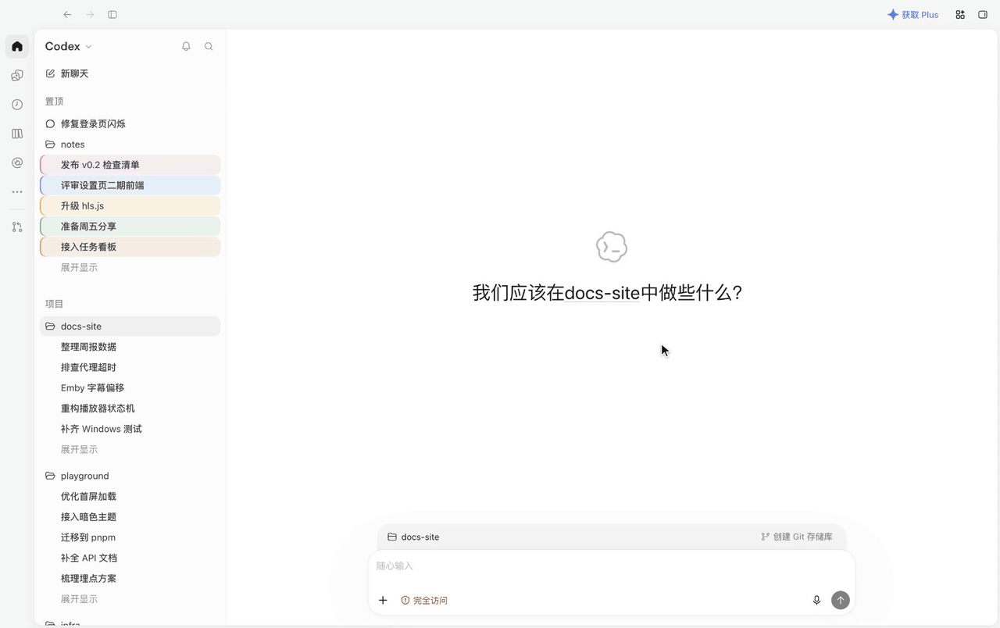
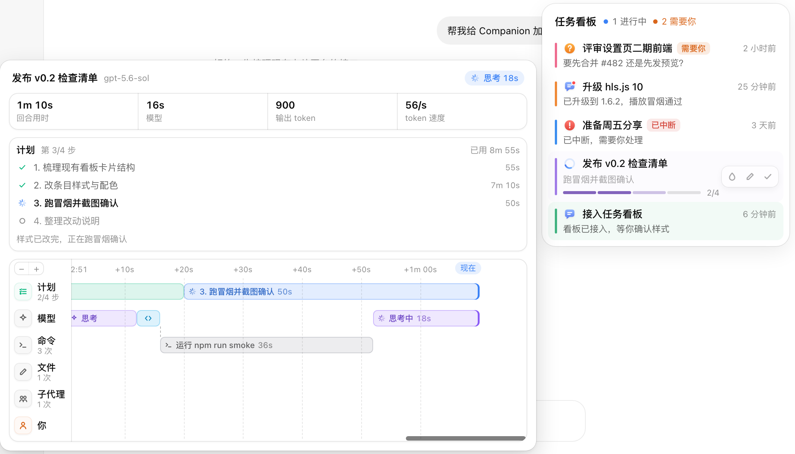
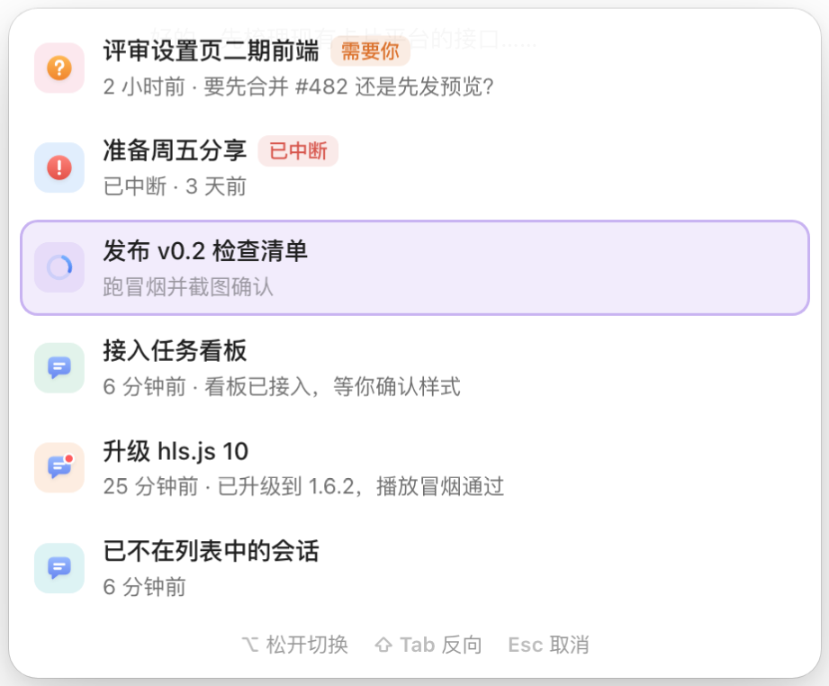
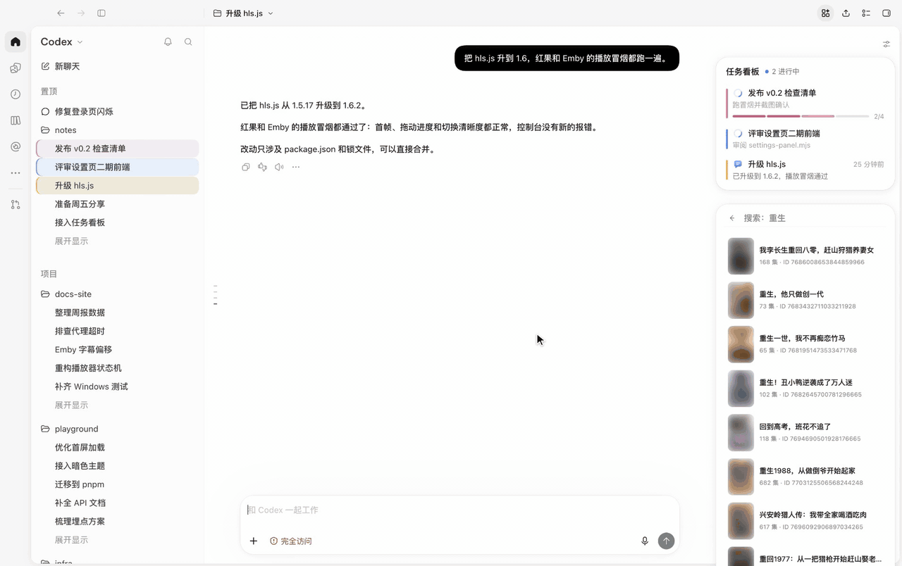
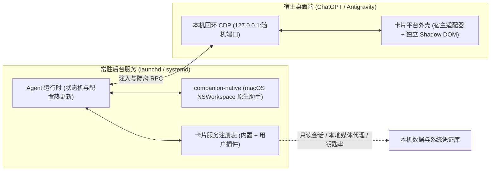

<div align="center">


# Agent Companion

**面向 AI Agent 桌面端的可扩展卡片与插件工作台。**

为 **ChatGPT** 与 **Antigravity** 注入多会话任务看板、实时执行 Trace、模型额度与可热插拔的卡片插件<br/>
——不修改 `app.asar`、不破坏应用签名，安装一次后台无感生效。

<p>
  <a href="https://github.com/foriLLL/agent-companion/releases/latest"></a>
  <a href="https://github.com/foriLLL/agent-companion/actions/workflows/ci.yml"></a>
  
  <a href="LICENSE"></a>
  <a href="https://github.com/topics/agent-companion-card"></a>
</p>

[English](README.md) · **简体中文**

[快速开始](#快速开始) · [内置卡片](#内置卡片) · [插件系统](#插件系统) · [工作原理](#工作原理) · [安全与隐私](#安全与隐私)

</div>

<br/>



---

## 为什么做 Agent Companion？

同时推进多个 AI Coding Agent 会话时，你不得不反复切窗口确认谁在等你授权、长任务卡在哪一步、额度还剩多少；等 Agent 跑测试或生成代码时，也常常希望对话旁边有一块可以随手放工具或播放器的扩展区——但桌面端都是封闭的 Electron 应用，无法直接装插件。

- **零侵入多宿主注入** — 同时支持 **ChatGPT** 与 **Antigravity**，通过后台常驻服务与本机回环调试端口注入界面，不改动 `app.asar`、安装包或应用签名。
- **多会话任务调度与观测** — 把并行会话钉在一处，按「需要你 / 未读 / 进行中」自动排序；悬停看多泳道执行 Trace（计划、模型、命令、文件、子代理、你），用 `⌥Tab` 极速切换、用 `⌥J` 一键跳到卡住等你确认的会话。
- **一切皆插件** — 内置卡片与社区卡片采用完全相同的插件包规范。一行 `agent-companion cards install owner/repo` 即可从任意 Git 仓库安装，几秒内热生效，无需中心化市场或重新构建。
- **AI 原生可扩展** — 卡片协议刻意保持极简（`manifest.json` + `renderer.mjs` + 可选 `service.mjs`）。直接告诉你的 Agent 想要什么卡片，几分钟就能写出来并热加载到对话旁。

---

## 支持的宿主与平台

| 宿主 | macOS（Apple Silicon / Intel） | Linux（x64 / ARM64） | Windows |
|---|---|---|---|
| **ChatGPT 桌面端** | **已支持** — `launchd` 后台自动安全重开刚启动（8 秒内、前台）的实例 | **预览** — 覆盖 `chatgpt.desktop` 菜单入口 + `systemd --user` 常驻（不自动退出） | 暂不支持 |
| **Antigravity** | **预览** — 同样支持启动与更新重启自动重开，或 `agent-companion antigravity [--restart]` | — | 暂不支持 |

---

## 快速开始

### macOS（Homebrew — 推荐）

```sh
brew tap foriLLL/agent-companion https://github.com/foriLLL/agent-companion
brew trust --formula foriLLL/agent-companion/agent-companion
brew install agent-companion
agent-companion agent install
```

Homebrew 会自动装好 Node.js 与 FFmpeg、在本地编译原生助手，并在后续有新正式版时自动后台更新。装好后重新打开一次 **ChatGPT** 或 **Antigravity** 即可看到卡片入口。

### 从源码安装（macOS / Linux）

```sh
git clone https://github.com/foriLLL/agent-companion.git
cd agent-companion
npm ci
npm start
```

`npm start` 一次完成渲染器打包、macOS 原生助手编译（需 Xcode Command Line Tools）、FFmpeg 检查以及登录自启后台服务注册（macOS：`launchd`；Linux：`systemd --user` + 菜单入口）。装好后请保留仓库目录；后续更新在仓库内执行 `git pull && npm ci && npm start`。

<details>
<summary><strong>环境要求、Linux 说明与可选 FFmpeg / HDR 配置</strong></summary>

- **宿主应用**：macOS 版 ChatGPT 桌面端（`/Applications/ChatGPT.app`）或 Linux 官方 deb/rpm 版（`/usr/lib/chatgpt/ChatGPT`，其它路径用 `AGENT_COMPANION_CODEX_EXECUTABLE` 指定），以及 macOS 版 Google Antigravity（`2.35+`）。
- **源码依赖**：`git`、Node.js `22+`、npm（devDependencies 内置固定版本 Bun），macOS 另需 Xcode Command Line Tools（`xcode-select --install`）。
- **Linux**：需 `systemd --user`；可选 `notify-send`（重开提醒）与 `secret-tool`（保存 Emby Token，缺失时退回 `0600` 文件）。安装写入 `~/.config/systemd/user/agent-companion-agent.service` 与 `~/.local/share/applications/chatgpt.desktop`（不会覆盖已有自定义文件）。请从应用菜单打开 ChatGPT，终端直接运行 `chatgpt` 不会带调试参数。
- **FFmpeg**：红果短剧播放必需；Emby 仅在 HEVC、EC-3、MKV、超高码率或图形字幕烧录时需要（任务看板、额度、代理状态及 Emby HLS / 兼容 MP4 均不需要）。项目不打包 FFmpeg，自动从 `AGENT_COMPANION_FFMPEG`、`PATH` 与常见包管理器目录查找。
  - macOS 杜比视界（P5/P8 RPU → BT.709 SDR）与 HDR10/HLG 色调映射需 `brew install ffmpeg-full molten-vk`。
- **数据目录**：`~/Library/Application Support/agent-companion/`（macOS） · `~/.config/agent-companion/`（Linux）。
- **关闭 Antigravity 宿主**：设置 `AGENT_COMPANION_ANTIGRAVITY=0`。

</details>

<details>
<summary><strong>手动升级与旧版迁移（Codex Companion / &lt; 0.2.0）</strong></summary>

- **Homebrew 手动升级**：
  ```sh
  brew upgrade agent-companion && agent-companion agent install
  ```
- **从 `< 0.2.0` 或改名前的 `Codex Companion` 升级**：
  Homebrew 7 按 formula 名字记录信任，执行一次升级脚本即可自动信任新 formula、迁移安装并重注册服务（或先执行 `brew trust --formula foriLLL/codex-companion/agent-companion` 再在设置里点「立即更新」）：
  ```sh
  curl -fsSL https://raw.githubusercontent.com/foriLLL/agent-companion/main/scripts/upgrade.sh | bash
  ```
  新版首次启动时会自动搬迁数据目录（旧路径保留软链）、交接 `com.codexcompanion.agent` → `com.agentcompanion.agent`，并完整沿用 Emby 凭证、卡片存档、计划提示标记段以及旧 `CODEX_COMPANION_*` 环境变量。

</details>

---

## 内置卡片

5 张内置卡片与用户自行安装的插件使用同一套规范，可在卡片区设置（齿轮）里自由开关与拖拽排序。

| 卡片 | 用途 | 适用宿主 | 默认 |
|---|---|---|---|
| **任务看板** | 集中跟踪多会话状态、计划进度、多泳道 Trace 与 `⌥Tab` / `⌥J` 极速切换 | ChatGPT、Antigravity | 开启 |
| **额度** | 剩余额度与重置倒计时：ChatGPT 用紧凑进度条（`codex app-server`），Antigravity 用分组圆环（Gemini + Claude / GPT） | ChatGPT、Antigravity | 关闭 |
| **代理状态** | 单行状态条实时显示 ChatGPT 启动代理与本机端口连通性 | ChatGPT | 开启 |
| **红果短剧** | 推荐瀑布流、搜索、片单折叠、选季选集与自动连播（需 FFmpeg） | ChatGPT、Antigravity | 开启 |
| **Emby** | 自建 Emby 客户端：多服务器、媒体库、续播、选源、字幕与播放进度上报 | ChatGPT、Antigravity | 开启 |

### 任务看板与实时 Trace

同时跑多个 Agent 任务时，不再需要挨个点开会话查进度：

- **待办优先排序** — 等你回答/授权、已中断或超过 15 分钟无响应的会话排最前，其次是未读新回复和进行中任务；侧栏同步标出任务色。
- **多泳道执行 Trace** — 鼠标停在任务上弹出可缩放时间线，按「计划 / 模型 / 命令 / 文件 / 子代理 / 你」分道展示；同一泳道内的并发工具调用自动分行排布，文字不重叠。
- **快捷键直达（macOS）** — 按住 `⌥` 连按 `Tab` 呼出最近使用排序的会话切换器（卡片收起时也能用，支持数字键 `1–9`、`W` 移出、`Z` 撤销）；按 `⌥J` 直接跳到下一个需要你处理的会话。
- **计划进度与自动加入** — 自动展示计划步骤进度条，并可选让桌面端新开的会话自动加入看板。





### 原生级双宿主体验

- **ChatGPT** — 顶栏入口图标自动对齐官方图标的颜色与线宽；卡片支持独立抽屉或排在原生 Summary 摘要下方。
- **Antigravity** — 顶栏入口紧贴 Overview 开关左侧（新建会话等无 Overview 页面自动挂到右上角 `⋮` 旁，不遮挡底部发送按钮），以无框羽化毛玻璃浮层（`⌥⌘J`）叠在对话右侧，窄屏下依然清晰不遮字。

### 边看边等（红果短剧 / Emby）

等长任务跑完的间隙在卡片里看剧或看片（含全屏），一旦看板上有任务等你授权或回复，视频会自动暂停并弹出提醒——点**「去处理」**（或按 `⌥J`）直接退出全屏跳回对应会话。



<details>
<summary><strong>更多细节：任务看板快捷键、长任务先列计划与 Antigravity 数据源</strong></summary>

- **快捷键定制**：可在任务看板设置里关闭快捷键、把 `⌥` 换成 `⌃`（`⌃Tab` / `⌃J`，适配 AltTab 用户），或让切换器一并列出看板外最近打开过的会话。
- **长任务先列计划**（仅 ChatGPT，默认关闭，开启前需明确确认）：在 `~/.codex/AGENTS.md`（或非空 `AGENTS.override.md`）追加带标记提示，并在 `~/.codex/config.toml` 写入带标记的 `[tools.update_plan] enabled = true`（已自行配置 `update_plan` 时不覆盖）。关闭开关或卸载时自动清理。
- **Antigravity 会话**：只读解析 `~/.gemini/antigravity/` 的会话摘要库与步骤记录，看板单独保存在 `task-board-antigravity.json`；自动加入只收桌面端会话，不收 `agy` 命令行会话。

</details>

<details>
<summary><strong>更多细节：Emby 播放路径与红果短剧说明 / 合规提示</strong></summary>

- **Emby**：`emby.json`（`0600`）只存服务器与用户元信息，`AccessToken` 存入系统凭证库（`agent-companion.emby`），密码绝不落盘。播放依次优先 H.264/AAC HLS、CDP 媒体拦截或 MP4Box/MSE 原生直出，仅对 HEVC、EC-3、超高码率或 PGS/VobSub/DVB 图形字幕走本机 FFmpeg（SRT/WebVTT/ASS/SSA 独立渲染不重编码）。连接前可用只读探针验证：`npm run probe:emby -- --server https://emby.example.com --username alice --search 三体`。
- **红果短剧**：经随包分发的非官方 wasm SDK [openhongguo](https://github.com/beilunyang/openhongguo) 以本机匿名设备档案（`hongguo/anonymous.json`）拉取公开片源，并经本机 FFmpeg 解密转封装播放（播放期间签名地址与 `-decryption_key` 会出现在本机 FFmpeg 命令行参数中，同一系统用户的进程可见）。内容与规则可能随时变化，请自行确认所在地法律、站点条款及内容权利；本项目不提供、托管或授权任何视频内容。

</details>

---

## 插件系统

Agent Companion 采用类似 Vim / Zsh 的去中心化插件机制：不运营中心市场，也不需要重新构建宿主或平台。

### 安装与管理社区卡片

在 GitHub 搜索 topic [`agent-companion-card`](https://github.com/topics/agent-companion-card) 发现社区卡片：

```sh
agent-companion cards install owner/agent-companion-card-pomodoro        # GitHub owner/repo
agent-companion cards install owner/agent-companion-card-pomodoro@v1.0.0 # 固定到 tag、分支或 commit
agent-companion cards install ./my-local-card                            # 从本地目录安装
agent-companion cards list                                               # 查看启用、关闭与加载失败的卡片
agent-companion cards update                                             # 更新未固定版本的卡片
agent-companion cards remove <id> [--purge]                              # 卸载（--purge 同时删卡片数据）
```

新安装的卡片**默认关闭**，在 Companion 设置里开启即可，也可以直接在设置的「插件」一节卸载自己安装的卡片（可选同时删除数据）。后台服务运行中时，安装、更新与卸载几秒内热生效。

### 让 AI 为你写一张卡片

在 **ChatGPT** 或 **Antigravity** 中直接描述你的需求：

```text
给 Agent Companion 写一张「番茄钟」卡片插件：25 分钟专注、5 分钟休息，
支持开始、暂停、重置，并把今天完成的番茄数存进卡片 storage。按 cards/README.md 规范来写。
```

也可以手动生成骨架并热开发：

```sh
agent-companion cards create pomodoro --title 番茄钟   # 需要后台服务时加 --service
cd pomodoro                                            # 编辑 renderer.mjs（以及 service.mjs）
agent-companion cards build                            # 打包界面 → renderer.js
agent-companion cards link .                           # 软链进卡片目录，之后每次 build 几秒内热生效
```

### 包结构与能力声明

| 文件 | 必需 | 说明 |
|---|---|---|
| `manifest.json` | 是 | 卡片清单：`id`、标题、`apiVersion`、布局、生命周期、存档范围、所需能力、可选 `hosts` |
| `renderer.mjs` → `renderer.js` | 是 | 页面入口，导出 `mount(ctx)`（及可选 `settings(kit)`），渲染在独立 `ShadowRoot` 内 |
| `service.mjs` | 否 | 可选后台服务，导出 `createService(api)`，对外以 `<卡片 id>.<方法名>` 暴露给本卡 |

卡片按需在清单中声明平台能力，未声明的能力不会出现在 `ctx` 上：

| 能力 | 提供的平台接口 |
|---|---|
| `storage` | 带版本号与校验的本地持久化（`target`、`session` 或后台可写的 `global`） |
| `rpc` | 调用本卡 `service.mjs` 的命名空间 RPC，卸载时自动取消在途请求 |
| `threads` | 读取宿主会话列表、给侧栏条目打色标并跳转打开会话 |
| `overlay` | 在卡片外框之外弹出顶层浮层（Trace 与 `⌥Tab` 切换器使用） |
| `attention` | 发送提醒，可在卡片有视频播放时自动暂停并支持一键「去处理」 |
| `host` | 获取当前宿主标识（`codex` \| `antigravity`）及宿主数据接口（如 Antigravity 模型额度） |

完整开发与发布规范见 **[cards/README.md](cards/README.md)** 与 **[AGENTS.md](AGENTS.md)**。

---

## 工作原理



- **安全自动重开（macOS）**：`companion-native` 经 `NSWorkspace` 监听启动，仅对刚启动 8 秒内且处于前台的普通实例请求正常退出（`NSRunningApplication.terminate()`，绝不强杀），再以本机随机调试端口重开并注入；已运行中的会话不会被自动打断。
- **分级宿主适配**：顶栏锚点与布局让位按稳定性分级降级，宿主页改版时也能保底可用；ChatGPT 升级后可运行 `npm run check:host` 只读自检。
- **自动更新**：Homebrew 安装每 6 小时检查一次 GitHub Release，发现新正式版后后台升级并重启后台服务（不重启 ChatGPT / Antigravity，视频播放中会等播完再重启）。

---

## 安全与隐私

- **仅限本机回环**：CDP 调试端口强制绑定 `127.0.0.1` 随机端口，绝不暴露到局域网或公网。
- **插件安全边界**：用户安装的卡片以当前用户权限运行、无沙箱，Agent Companion 不审核或签名第三方插件；请只安装信任来源并建议固定 `@tag`。**关闭的插件不运行任何代码**（界面不注入、后台服务不加载）。
- **凭证隔离**：Emby Token 存于系统凭证库（`agent-companion.emby`），仅发往配置的 Emby 源站，不进入 DOM、媒体 URL、FFmpeg 命令行或日志。
- **零遥测**：本地会话记录（`~/.codex`、`~/.gemini/antigravity`）只读不上传；检查更新仅请求 GitHub Release，User-Agent 只带 `agent-companion/<版本号>`。
- **锁定依赖与媒体校验**：依赖版本由 `package-lock.json` 精确锁定，运行时不加载外部 CDN 脚本；跨源媒体 CDN 强制 HTTPS 及 DNS/公网 IP 校验。
- **已知例外**：红果短剧播放期间，签名地址与内容密钥需经命令行参数传给本机 FFmpeg，同一系统用户的其他进程可见。

安全漏洞请按 **[SECURITY.md](SECURITY.md)** 私下报告。

---

## 已知边界

- 界面目前仅提供**简体中文**。
- **Linux** 为预览版（登录后会话页的卡片布局尚未完整验证）；**Windows** 暂不支持。
- **Antigravity** 为 macOS 预览版；任务看板按字段号解析本地 protobuf 摘要库，Antigravity 升级改动格式时可能需要跟进适配。
- 安装前已在运行且未带调试参数的宿主，需要手动重开一次（Antigravity 可用 `agent-companion antigravity --restart`）。
- Emby 不支持 Emby Connect、Live TV、音频库、DRM 及自签名 HTTPS 证书。
- 宿主 DOM 改版后可能出现局部样式降级，可运行 `npm run check:host` 检查。

---

## 开发与卸载

<details>
<summary><strong>常用开发命令</strong></summary>

```sh
npm test                                         # 使用 Node 内置测试运行器（不要用 bun test）
npm run smoke                                    # Chromium 冒烟测试
node scripts/smoke-codex-adapter.mjs             # ChatGPT 适配分级冒烟
node scripts/smoke-antigravity-adapter.mjs       # Antigravity 适配分级冒烟
npm run check:host                               # ChatGPT 升级后只读适配自检
npm run card:create -- my-card --title 我的卡片  # 生成内置卡片骨架
node src/cli.mjs agent                           # 前台运行后台服务
node scripts/build-native.mjs                    # 重新编译 macOS 原生助手
npm run release -- X.Y.Z                         # 发版：改版本号、整理 CHANGELOG、提交并打 tag（不推送）
```

开发规范见 [AGENTS.md](AGENTS.md) 与 [CONTRIBUTING.md](CONTRIBUTING.md)。

</details>

<details>
<summary><strong>卸载方式</strong></summary>

- **Homebrew 安装**：
  ```sh
  agent-companion agent uninstall
  brew uninstall agent-companion && brew untap foriLLL/agent-companion
  ```
- **源码安装**：
  ```sh
  node src/cli.mjs agent uninstall
  ```
  之后删除仓库目录即可。
- **彻底清除数据（可选，不可恢复）**：手动删除 `~/Library/Application Support/agent-companion/`（macOS）或 `~/.config/agent-companion/`（Linux），并在「钥匙串访问」中删除 `agent-companion.emby`。

</details>

---

## 参与贡献与许可

欢迎提交 Issue 与 PR，详见 [CONTRIBUTING.md](CONTRIBUTING.md)、[CHANGELOG.md](CHANGELOG.md) 与 [THIRD_PARTY_NOTICES.md](THIRD_PARTY_NOTICES.md)。

本项目基于 [MIT License](LICENSE) 开源。

---

<sub><strong>免责声明：</strong>Agent Companion 是独立的非官方项目，与 OpenAI、ChatGPT、Codex、Google、Antigravity、字节跳动、红果短剧及 Emby 均无隶属、授权或背书关系；相关名称和商标归各自权利人所有。</sub>
